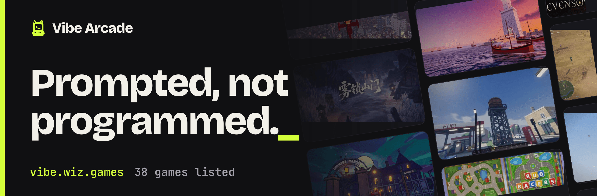
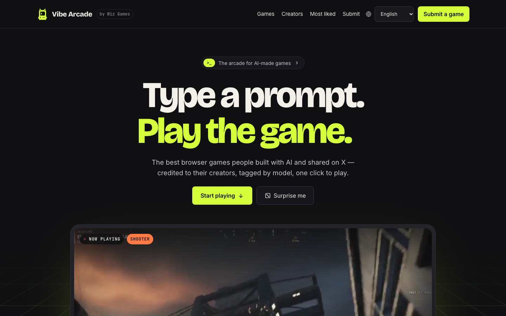

# Vibe Arcade

[English](README.md) · [简体中文](README.zh-CN.md) · [繁體中文](README.zh-TW.md) · 日本語 · [한국어](README.ko.md)

**[vibe.wiz.games](https://vibe.wiz.games/?lang=ja)** · [ゲームを投稿する](https://github.com/yldm-tech/awesome-vibe-games/issues/new?template=submit-game.yml) · [ゲーム一覧](#ゲーム一覧) · [掲載の基準](#掲載の基準)

[](https://github.com/yldm-tech/awesome-vibe-games/actions/workflows/ci.yml)



Vibe Arcade は AI でつくったゲームのアーケードです。主に AI モデルへのプロンプトで作られ、X で公開されたブラウザゲームを、人の手で選んで集めたインデックスです。各エントリには、ゲームを作ったモデル、作者、元の投稿とそのいいね数、プレイ用のリンクを記録しています。このリポジトリにあるのはゲームのデータと、それを表示するサイト [vibe.wiz.games](https://vibe.wiz.games/?lang=ja) です。ゲームそのものは各作者のもので、それぞれのホストに置かれたままです。

## サイトでできること

- **ワンクリックでプレイ。** どのカードからも、ブラウザで動くゲームと、作者の X 投稿へ直接飛べます。
- **どう作られたかがわかる。** すべてのゲームに制作モデルを明記。作者が公表していれば、制作時間、費用、トークン数、プロンプトそのものも載せています。
- **遊ぶ前に見られる。** トップの画面と、ポインタを乗せたカードで、作者の投稿から切り出した無音のショートクリップが流れます。
- **好きな探し方で。** ジャンル、モデル、クリエイターで絞り込み、タイトルで検索し、いいね順か日付順に並べ替えられます。どの表示もそのまま共有できる URL で、ゲームごとに専用のページもあります。
- **10 言語。** 画面の文言とすべてのゲーム紹介が 10 言語に対応。英語はパラメータなしの URL、その他は `?lang=<code>` です。



## ゲーム一覧

サイトに載っているすべてのゲームを、いいねの多い順に並べています。ゲーム名は Vibe Arcade 上のページへ、最後の列はゲーム本体と作者の投稿へのリンクです。この一覧は `packages/catalog/data/games/` のデータから生成したもので、`pnpm --filter @vibe-arcade/web readme` で作り直します。

<!-- games:start -->
**38** 本のゲーム · **31** 人のクリエイター · **2** 個のAIモデル

| # | ゲーム | クリエイター | ジャンル | モデル | |
| --- | --- | --- | --- | --- | --- |
| 1 | [**Starry Night Rider**](https://vibe.wiz.games/games/starry-night-rider?lang=ja)<br>ゴッホと一緒に彼の「星月夜」の中を駆け抜ける。 | [@ebbyamir](https://x.com/ebbyamir) | 探索 | Claude Fable 5.2 | [プレイ](https://starrynightrider.com) · [投稿](https://x.com/i/status/2120284261089673376) |
| 2 | [**Saltline**](https://vibe.wiz.games/games/saltline?lang=ja)<br>ワンショットで作られたFPS。モデル・音・テクスチャはすべてコード生成、人の手直しなし。 | [@felixrieseberg](https://x.com/felixrieseberg) | シューター | Claude Fable 5.2 | [プレイ](https://claude.ai/artifact/BGY1SztrAYcJQHSsnHHGmp) · [投稿](https://x.com/i/status/2119925633564463609) |
| 3 | [**What the Water Keeps**](https://vibe.wiz.games/games/what-the-water-keeps?lang=ja)<br>8つの夢のような世界をめぐる、穏やかなボートの旅。 | [@kevin_t_ngo](https://x.com/kevin_t_ngo) | 探索 | Claude Fable 5.2 | [プレイ](https://what-the-water-keeps.vercel.app/) · [投稿](https://x.com/i/status/2119868968307695818) |
| 4 | [**Mirror Earth**](https://vibe.wiz.games/games/mirror-earth?lang=ja)<br>地球まるごと破壊できるゲーム世界。天気は現実の地球と連動。 | [@mattshumer_](https://x.com/mattshumer_) | サンドボックス | Claude Fable 5.2 | [プレイ](https://www.spawn.co/@mattshumer/earth) · [投稿](https://x.com/i/status/2119877065701036047) |
| 5 | [**Portals: Endless Worlds**](https://vibe.wiz.games/games/portals-endless-worlds?lang=ja)<br>ポータルでつながる450以上のコードだけの3D世界。25,000のエージェントが構築。 | [@emollick](https://x.com/emollick) | 探索 | Claude Fable 5.2 | [プレイ](https://portals-endless-worlds.netlify.app/) · [投稿](https://x.com/i/status/2119918307457577163) |
| 6 | [**Evensong**](https://vibe.wiz.games/games/evensong?lang=ja)<br>ブラウザで遊べるダークファンタジーのボス戦。 | [@kevin_t_ngo](https://x.com/kevin_t_ngo) | アクション | Claude Fable 5.2 | [見る](https://x.com/i/status/2120238844754923874) |
| 7 | [**雾锁山门**](https://vibe.wiz.games/games/wu-suo-shan-men?lang=ja)<br>午後だけで45億トークン。モデル、シーン、モーション、最適化をすべて30MBのHTML1枚に。 | [@op7418](https://x.com/op7418) | アクション | Claude Fable 5.2 | [プレイ](https://op7418.github.io/guizang-game-skill/) · [投稿](https://x.com/i/status/2120694045299327187) |
| 8 | [**Voxel Engine**](https://vibe.wiz.games/games/voxel-engine?lang=ja)<br>1つのプロンプトから作られたサウンド付きボクセルエンジン。 | [@mattshumer_](https://x.com/mattshumer_) | サンドボックス | Claude Fable 5.2 | [プレイ](https://www.spawn.co/@mattshumer/voxel-engine) · [投稿](https://x.com/i/status/2119870965106483384) |
| 9 | [**Siege Wing**](https://vibe.wiz.games/games/siege-wing?lang=ja)<br>ヘリで中世の戦場へ。大砲・ロケット・ミサイルでバリスタと城に挑む。 | [@builderjaydub](https://x.com/builderjaydub) | シューター | Claude Fable 5.2 | [プレイ](https://bannerfall.itch.io/siege-wing) · [投稿](https://x.com/i/status/2120223731520040966) |
| 10 | [**I Would Have Gotten Away With It**](https://vibe.wiz.games/games/i-would-have-gotten-away-with-it?lang=ja)<br>逆スクービー・ドゥー。悪役になって子どもたちを怖がらせて追い払う。 | [@emollick](https://x.com/emollick) | ストーリー・シム | Claude Fable 5.2 | [プレイ](https://i-would-have-gotten-away-with-it.netlify.app/) · [投稿](https://x.com/i/status/2119876449494540554) |
| 11 | [**Patchwork Quilt**](https://vibe.wiz.games/games/patchwork-quilt?lang=ja)<br>パッチワークのコマ撮り風おもちゃの世界。 | [@BlendiByl](https://x.com/BlendiByl) | パズル・おもちゃ | Claude Fable 5.2 | [プレイ](https://patch.gg/blendi/patchwork-quilt) · [投稿](https://x.com/i/status/2120746541636047347) |
| 12 | [**Childhood Rug Racer**](https://vibe.wiz.games/games/childhood-rug-racer?lang=ja)<br>子どもの頃の遊びマットの上でおもちゃの車レース。 | [@noclipepe](https://x.com/noclipepe) | レース | GPT-6.2 Sol vs Fable | [プレイ](https://noclipepe.pages.dev/rug/) · [投稿](https://x.com/i/status/2119728047754547326) |
| 13 | [**Cloud Stunt 3D**](https://vibe.wiz.games/games/cloud-stunt-3d?lang=ja)<br>30分で生成されたスタントゲーム。 | [@jev_chat](https://x.com/jev_chat) | レース | Claude Fable 5.2 | [プレイ](https://finderchangchang.github.io/cloud-stunt-3d/) · [投稿](https://x.com/i/status/2120015641151426838) |
| 14 | [**Hogwarts Royale**](https://vibe.wiz.games/games/hogwarts-royale?lang=ja)<br>1行のプロンプトから生まれた魔法学校バトロワ。 | [@mattshumer_](https://x.com/mattshumer_) | アクション | Claude Fable 5.2 | [プレイ](https://www.spawn.co/@mattshumer/hogwarts-royale) · [投稿](https://x.com/i/status/2119872098306810226) |
| 15 | [**Dread and District**](https://vibe.wiz.games/games/dread-and-district?lang=ja)<br>ファンタジー物流シム。優れたサプライチェーンが悪を倒す。エージェント群で制作。 | [@emollick](https://x.com/emollick) | ストーリー・シム | Claude Fable 5.2 | [プレイ](https://dread-and-district.netlify.app) · [投稿](https://x.com/i/status/2120248525254742318) |
| 16 | [**Worm Rider**](https://vibe.wiz.games/games/worm-rider?lang=ja)<br>Claude Codeで作った220KBのオープンソースゲーム。 | [@AmirMushich](https://x.com/AmirMushich) | アクション | Claude Fable 5.2 | [ソース](https://github.com/amirmushichge/worm-rider) · [投稿](https://x.com/i/status/2119937977426338283) |
| 17 | [**Maad Maxxing**](https://vibe.wiz.games/games/maad-maxxing?lang=ja)<br>100%コード、アセットなし。Three.js + WebGPU、最初の3ステージがプレイ可能。 | [@Andrew_Blumson](https://x.com/Andrew_Blumson) | レース | Claude Fable 5.2 | [プレイ](https://maad-maxxing.vercel.app) · [投稿](https://x.com/i/status/2120599812512833557) |
| 18 | [**Frontline Warfare Deathmatch**](https://vibe.wiz.games/games/frontline-warfare-deathmatch?lang=ja)<br>ブラウザで遊べるミリタリーシューターのデスマッチ。 | [@alightinastorm](https://x.com/alightinastorm) | シューター | Claude Fable 5.2 | [プレイ](https://spawn.co/@robot/frontline-warfare-deathmatch) · [投稿](https://x.com/i/status/2120020469487440210) |
| 19 | [**Lanternfall**](https://vibe.wiz.games/games/lanternfall?lang=ja)<br>モデル、アニメ、エフェクトすべて生成。敵の死亡モーションまで。 | [@loktar00](https://github.com/loktar00) | アクション | Claude Fable 5.2 | [プレイ](https://loktar00.github.io/lanternfall/) · [投稿](https://x.com/i/status/2120279060303520034) |
| 20 | [**Rambo Dino**](https://vibe.wiz.games/games/rambo-dino?lang=ja)<br>ChromeのT-Rexゲームをアクションゲームに作り替え。 | [@noclipepe](https://x.com/noclipepe) | アクション | Claude Fable 5.2 | [プレイ](https://noclipepe.pages.dev/dino) · [投稿](https://x.com/i/status/2119927838321328577) |
| 21 | [**Turbo Tails**](https://vibe.wiz.games/games/turbo-tails?lang=ja)<br>6人のレーサー、ドリフト、ジャンプ台、アイテム、マルチプレイ対応の3Dカートレース。 | [@petergyang](https://x.com/petergyang) | レース | Claude Fable 5.2 | [プレイ](https://turbo-tails.vercel.app) · [投稿](https://x.com/i/status/2119901658394358005) |
| 22 | [**Spud Smash**](https://vibe.wiz.games/games/spud-smash?lang=ja)<br>青い椅子を叩き壊して燃やすジャガイモ。 | [@argofowl](https://x.com/argofowl) | アクション | Claude Fable 5.2 | [プレイ](https://fowllabs.com/fable-5-2/spud-smash) · [投稿](https://x.com/i/status/2119913148929187960) |
| 23 | [**Skyflare**](https://vibe.wiz.games/games/skyflare?lang=ja)<br>3時間で作った戦闘機ゲーム。 | [@AugustCastilIo](https://x.com/AugustCastilIo) | シューター | Claude Fable 5.2 | [プレイ](https://skyflare-game.vercel.app) · [投稿](https://x.com/i/status/2120290751502581879) |
| 24 | [**Feed the Backrooms**](https://vibe.wiz.games/games/feed-the-backrooms?lang=ja)<br>怪物になって、バックルームに迷い込んだ人を捕まえる。 | [@LexnLin](https://x.com/LexnLin) | ストーリー・シム | Claude Fable 5.2 | [プレイ](https://feed-backrooms.vercel.app) · [投稿](https://x.com/i/status/2119966127149429093) |
| 25 | [**Stray Cat**](https://vibe.wiz.games/games/stray-cat?lang=ja)<br>子猫を救い、犬を脅かし、老いたボス猫に挑む。音はコードで合成。 | [@aimikoda](https://x.com/aimikoda) | ストーリー・シム | Claude Fable 5.2 | [プレイ](https://claude.ai/artifact/4nPXUKJjQWNsZEHVNmXXCt) · [投稿](https://x.com/i/status/2120120133712593118) |
| 26 | [**Tilt Labyrinth**](https://vibe.wiz.games/games/tilt-labyrinth?lang=ja)<br>約2,000行のThree.jsで作った木製ボール迷路。 | [@mylifcc](https://x.com/mylifcc) | パズル・おもちゃ | Claude Fable 5.2 | [プレイ](https://blog.silencestar.com/posts/tilt-labyrinth/play/) · [投稿](https://x.com/i/status/2120054646282870910) |
| 27 | [**Tiny Planet**](https://vibe.wiz.games/games/tiny-planet?lang=ja)<br>歩き回れる小さな惑星。オープンソース。 | [@prasenx](https://x.com/prasenx) | 探索 | Claude Fable 5.2 | [ソース](https://github.com/StarKnightt/tiny-planet) · [投稿](https://x.com/i/status/2120188077855613174) |
| 28 | [**The Vast Horizon**](https://vibe.wiz.games/games/the-vast-horizon?lang=ja)<br>ひとつの湖をみんなでサーフィン。言葉を入力すると世界が変わる。 | [@OdinLovis](https://x.com/OdinLovis) | 探索 | Claude Fable 5.2 | [プレイ](https://the-vast-horizon.vercel.app) · [投稿](https://x.com/i/status/2120198469755503091) |
| 29 | [**Dead Headway**](https://vibe.wiz.games/games/dead-headway?lang=ja)<br>スピードラン向けの短いゲーム。 | [@AugustCastilIo](https://x.com/AugustCastilIo) | アクション | Claude Fable 5.2 | [プレイ](https://dead-headway.vercel.app) · [投稿](https://x.com/i/status/2120628693420904489) |
| 30 | [**Silicon Seduction**](https://vibe.wiz.games/games/silicon-seduction?lang=ja)<br>誘惑されずに脱出せよ。 | [@ZryMiller](https://x.com/ZryMiller) | ストーリー・シム | Claude Fable 5.2 | [プレイ](https://silicon-seduction.vercel.app/) · [投稿](https://x.com/i/status/2119918766691954691) |
| 31 | [**Reef Dive**](https://vibe.wiz.games/games/reef-dive?lang=ja)<br>銛で魚を突き、サメをかわし、潜水艇で水深140mのブルーホールへ。 | [@boona11](https://x.com/boona11) | 探索 | Claude Fable 5.2 | [プレイ](https://wavedash.com/games/reef-dive) · [投稿](https://x.com/i/status/2120482516733702472) |
| 32 | [**Bayhaven**](https://vibe.wiz.games/games/bayhaven?lang=ja)<br>全長3.2kmの海岸線をドライブ＆ドリフト。市バスから跳ねるローライダーまで14台。 | [@FablestarGames](https://x.com/FablestarGames) | サンドボックス | Claude Fable 5.2 | [プレイ](https://fablestar.games/play/) · [投稿](https://x.com/i/status/2120641504951603394) |
| 33 | [**Roost**](https://vibe.wiz.games/games/roost?lang=ja)<br>AIライバル、ニトロ、ハンドル視点のダートバイクレース。 | [@tejas3732](https://x.com/tejas3732) | レース | Claude Fable 5.2 | [プレイ](https://claude.ai/artifact/DLnFodkTwvawCNwurDmSZK) · [投稿](https://x.com/i/status/2120091513657139549) |
| 34 | [**Courtyard Kings**](https://vibe.wiz.games/games/courtyard-kings?lang=ja)<br>39のボイスと効果音を備えた4キャラ格闘ゲーム。 | [@promodenstudio](https://x.com/promodenstudio) | アクション | Claude Fable 5.2 | [プレイ](https://claude.ai/artifact/1QGGhB68jMCjjjeeKtKNUo) · [投稿](https://x.com/i/status/2120085977079107788) |
| 35 | [**Tria Prima**](https://vibe.wiz.games/games/tria-prima?lang=ja)<br>ダークファンタジーの錬金術。オープンワールドの島で5つのミッション。 | [@winchxyz](https://x.com/winchxyz) | ストーリー・シム | Claude Fable 5.2 | [プレイ](https://winchxyz.github.io/tria-prima/) · [投稿](https://x.com/i/status/2120078399482020160) |
| 36 | [**Stonehenge Solstice**](https://vibe.wiz.games/games/stonehenge-solstice?lang=ja)<br>HTML1枚のストーンヘンジ。草、影、夏至の太陽の軌道。 | [@MeltTheManual](https://x.com/MeltTheManual) | パズル・おもちゃ | Claude Fable 5.2 | [プレイ](https://meltthemanual.github.io/stonehenge-solstice/) · [投稿](https://x.com/i/status/2119926820963532984) |
| 37 | [**Fortnite in Three.js**](https://vibe.wiz.games/games/fortnite-in-three-js?lang=ja)<br>Three.jsで作ったバトロワのクローン。 | [@aabyzov](https://x.com/aabyzov) | アクション | Claude Fable 5.2 | [プレイ](https://anton-abyzov.github.io/fortnite-3js/) · [投稿](https://x.com/i/status/2120702690845933702) |
| 38 | [**Vippi**](https://vibe.wiz.games/games/vippi?lang=ja)<br>テンポの速いアーケード風FPS。 | [@Shrit1401](https://x.com/Shrit1401) | シューター | Claude Fable 5.2 | [プレイ](https://vippi.vercel.app/) · [投稿](https://x.com/i/status/2120060593763926314) |
<!-- games:end -->

## 掲載の基準

次の 3 つを満たすゲームを掲載します。

- **主に AI が作ったもの。** コード、アート、サウンドのいずれかが AI モデルで生成されていて、どのモデルかを作者が明かしていること。
- **ブラウザで遊べること。** ワンクリックで遊べて、インストールも登録の壁もないこと。ソースのリポジトリや動画しかないゲームも掲載でき、その旨を表示します。
- **X で公開されていること。** すべてのエントリは作者の元の投稿にリンクし、いいね数もその投稿から数えます。

モデルもエンジンも問いません。いいね数はエントリを最後に更新した時点の値で、リアルタイムの数字ではありません。

## ゲームを投稿する

- [Submit a game](https://github.com/yldm-tech/awesome-vibe-games/issues/new?template=submit-game.yml) の issue フォームを開いてください。ゲーム名、作者の X ハンドル、投稿、リンク、ジャンル、モデル、英語での一行説明を入力します。作者本人でなくてもかまいません。
- または、遊べるリンクを付けてゲームを X に投稿し、[@suzukaze_haduki](https://x.com/suzukaze_haduki) をタグ付けしてください。

[投稿ワークフロー](.github/workflows/submissions.yml)が、人の手を介さず数分でゲームを掲載します。投稿が存在し作者本人のものか、プレイ用またはソースのリンクが応答するか、まだ掲載されていないかを確かめたうえで、投稿からカバー、クリップ、作者のアバターを取り、issue を閉じるプルリクエストを開き、CI が通ればマージしてサイトをデプロイします。問題があれば issue にその旨を書き込み、issue を編集すると再試行します。概要はまず英語で載り、翻訳されるまで他の言語でも英語が表示されます。ゲームのファイルを自分で追加する pull request も歓迎します。

## ゲームファイルの形式

ゲームは 1 本につき 1 つの JSON ファイルで、`packages/catalog/data/games/<slug>.json` に置きます。[`game.schema.json`](packages/catalog/data/schema/game.schema.json) とカタログのテストで検証されます。以下は、`creatorUrl` 以外のすべてのフィールドを使っているエントリ [`saltline.json`](packages/catalog/data/games/saltline.json) です（`creatorUrl` の例は [`lanternfall.json`](packages/catalog/data/games/lanternfall.json) にあります）。

<details>
<summary><code>saltline.json</code> の全文</summary>

```json
{
  "$schema": "../schema/game.schema.json",
  "slug": "saltline",
  "name": "Saltline",
  "creator": "felixrieseberg",
  "genre": "Shooter",
  "link": {
    "type": "play",
    "url": "https://claude.ai/artifact/BGY1SztrAYcJQHSsnHHGmp"
  },
  "post": "2119925633564463609",
  "likes": 14391,
  "model": "Claude Fable 5.2",
  "cover": "saltline.webp",
  "summary": {
    "en": "One-shot FPS. Models, sounds and textures all generated in code, no human feedback.",
    "zh-CN": "一次性提示生成的 FPS。模型、音效、纹理全部用代码生成，无人工反馈。",
    "zh-TW": "一次性提示生成的 FPS。模型、音效、材質全部用程式碼生成，無人工回饋。",
    "ja": "ワンショットで作られたFPS。モデル・音・テクスチャはすべてコード生成、人の手直しなし。",
    "ko": "원샷 프롬프트로 만든 FPS. 모델, 사운드, 텍스처 모두 코드로 생성, 사람 피드백 없음.",
    "es": "FPS hecho con prompts de una sola vez. Modelos, sonidos y texturas generados en código, sin feedback humano.",
    "fr": "Un FPS fait en prompts uniques. Modèles, sons et textures générés en code, sans retour humain.",
    "de": "Ein One-Shot-Shooter. Modelle, Sounds und Texturen komplett im Code erzeugt, ohne menschliches Feedback.",
    "pt-BR": "Um FPS feito com prompts únicos. Modelos, sons e texturas gerados em código, sem feedback humano.",
    "ru": "FPS из одноразовых промптов. Модели, звуки и текстуры сгенерированы кодом, без участия человека."
  },
  "pitch": {
    "en": "A first-person shooter built from one-shot prompts with no human feedback. Models, sounds and textures are all generated in code.",
    "zh-CN": "一款由一次性提示、无人工反馈做出的第一人称射击游戏。模型、音效和纹理全部由代码生成。",
    "zh-TW": "一款由一次性提示、無人工回饋做出的第一人稱射擊遊戲。模型、音效和材質全部由程式碼生成。",
    "ja": "人のフィードバックなし、ワンショットのプロンプトで作られたFPS。モデル・サウンド・テクスチャはすべてコードで生成。",
    "ko": "사람의 피드백 없이 원샷 프롬프트로 만든 1인칭 슈터. 모델, 사운드, 텍스처 모두 코드로 생성했습니다.",
    "es": "Un shooter en primera persona creado con prompts únicos, sin feedback humano. Modelos, sonidos y texturas generados en código.",
    "fr": "Un FPS construit à partir de prompts uniques, sans retour humain. Modèles, sons et textures sont tous générés en code.",
    "de": "Ein Ego-Shooter aus One-Shot-Prompts, ohne menschliches Feedback. Modelle, Sounds und Texturen sind komplett im Code erzeugt.",
    "pt-BR": "Um FPS criado com prompts únicos, sem feedback humano. Modelos, sons e texturas foram todos gerados em código.",
    "ru": "Шутер от первого лица, созданный одноразовыми промптами без участия человека. Модели, звуки и текстуры сгенерированы кодом."
  },
  "notes": {
    "time": "8h",
    "cost": "~$550",
    "tokens": "2.7M out · 445M in"
  }
}
```

</details>

| フィールド | 必須 | 意味 |
| --- | --- | --- |
| `$schema` | はい | 常に `../schema/game.schema.json`。 |
| `slug` | はい | `.json` を除いたファイル名で、サイト上でのゲームのアドレスにもなります。名前を小文字にし、`a-z` と `0-9` 以外の文字の連続をそれぞれ 1 つのハイフンに置き換え、両端にハイフンを残しません。`Portals: Endless Worlds` は `portals-endless-worlds` になります。 |
| `name` | はい | 作者の表記どおりのゲーム名。 |
| `creator` | はい | 作者の X ハンドル。`@` は付けません。 |
| `creatorUrl` | いいえ | 作者のページが X のプロフィールではない場合に指定します。省略すると `https://x.com/<creator>` にリンクします。 |
| `genre` | はい | `Shooter`、`Racing`、`Action`、`Exploration`、`Sandbox`、`Story & sim`、`Puzzle & toys` のいずれか。 |
| `link.type` | はい | ブラウザで動くゲームは `play`、リポジトリは `source`、動画でしか見られないゲームは `watch`。 |
| `link.url` | `play` と `source` では必須 | ゲームを遊べる場所、またはソースを読める場所。`watch` のエントリでは省略でき、その場合は投稿にリンクします。 |
| `post` | はい | 作者の X 投稿の id。投稿のアドレスの末尾にある数字で、JSON の数値には大きすぎるため文字列で書きます。ゲームに表示される日付はこの id から求めます。 |
| `likes` | はい | エントリを最後に更新した時点での投稿のいいね数。整数。 |
| `model` | はい | ゲームの制作に使われた AI モデル。作者の呼び方どおりに書きます。 |
| `cover` | はい | カバーのファイル名 `<slug>.webp`。`apps/web/public/covers/` に置く 960x600 の画像です。 |
| `summary` | はい | カードに載せるゲームの一行説明。`en` は必須で、ほかの言語は任意です。書かれていない言語では英語が表示されます。 |
| `pitch` | いいえ | ゲームのページと、ピックアップに選ばれたときに表示される長めの説明。言語の扱いは `summary` と同じです。 |
| `notes` | いいえ | 作者が公表した制作データを、書かれたとおりに。`time`、`cost`、`tokens`、`prompts`、`lines`、`size`、`agents` のいずれかと、ゲームの元になったプロンプト `prompt`。ゲームの「制作データ」として表示されます。 |
| `down` | いいえ | ゲームをリンク切れとしてマークした日（`YYYY-MM-DD`）。毎日のリンクチェックが、自身のプルリクエストを通じて書き込み、取り除きます。設定されているあいだもゲームは掲載されたままで、リンク切れであることを表示し、作者の投稿へ案内します。 |

## 言語

サイトと各ゲームの概要は 10 言語で用意しています。English（`en`、既定）、简体中文（`zh-CN`）、繁體中文（`zh-TW`）、日本語（`ja`）、한국어（`ko`）、Español（`es`）、Français（`fr`）、Deutsch（`de`）、Português（`pt-BR`）、Русский（`ru`）です。英語はパラメータなしのアドレスで、その他の言語は `?lang=<code>` で表示します。画面の文言は `packages/catalog/locales/<code>.json` にあり、言語ごとに 1 ファイルで、キーは共通です。

## リポジトリの構成

2 つのパッケージからなる pnpm モノレポです。

```text
apps/web/                  @vibe-arcade/web：サイト。TanStack Start（React 19）を Cloudflare Workers 上でレンダリング
  src/                     ルート、コンポーネント、スタイル
  public/covers/           ゲームのカバー、<slug>.webp
  public/videos/           ゲームの無音ショートクリップ、<slug>.mp4。hero/<slug>.mp4 はヒーロー画面用
  public/avatars/          クリエイターのアバター、<handle>.webp
  public/fonts/            セルフホストの Web フォント
  og/                      ビルド時に共有用画像を描く Vite プラグイン
  scripts/                 fetch-covers.ts、fetch-media.ts、readme-games.ts、site-icons.ts、banner.ts
  wrangler.jsonc           Cloudflare Workers の設定
packages/catalog/          @vibe-arcade/catalog：データと、そこから導かれるものすべて
  data/games/              ゲーム 1 本につき 1 つの JSON ファイル
  data/schema/             game.schema.json
  data/meta.json           データを最後に変更した日（サイトの「最終更新」）と今週のピックアップ
  data/media.json          クリップのあるゲームとアバターのあるクリエイターの一覧。fetch-media.ts が書き出す
  locales/                 画面の文言、言語ごとに 1 ファイル
  src/                     読み込みと検証、絞り込み、言語、サイトの定数
.github/
  ISSUE_TEMPLATE/          Submit a game フォーム
  workflows/ci.yml         すべての pull request と main で型チェック、テスト、ビルド
  workflows/deploy.yml     main で CI が通ったら Cloudflare Workers にデプロイ
  workflows/links.yml      全ゲームのリンクを毎日チェックし、切れたままのゲームをマークするプルリクエストを出す
```

毎日の[リンクチェック](.github/workflows/links.yml)は、各ゲームのプレイ用またはソースのリンクにリクエストを送ります。応答しないリンクは「Dead game links」というタイトルの 1 つの issue に載り、連続して何回切れていたかもそこに記録されます。3 回続くとゲームはリンク切れとしてマークされ（ファイルの `down`）、ホストが 1 日落ちただけではマークされません。マークされたゲームのリンクが再び応答すれば、マークは外れます。どの変更もプルリクエストを通じて反映され、CI が通れば自動でマージされてサイトがデプロイされます。ゲームが移転しただけなら `link.url` を直せば、次のチェックでマークが外れます。

## 開発

Node.js 24 以降と pnpm が必要です。

```sh
pnpm install     # 依存パッケージをインストール
pnpm dev         # サイトをローカルで起動
pnpm test        # 両パッケージのテストを実行
pnpm typecheck   # 両パッケージを型チェック
pnpm build       # サイトをビルド（共有用画像を含む）
```

`apps/web` の次のスクリプトは、コミット対象のファイルを書き出します。

```sh
pnpm --filter @vibe-arcade/web covers   # 各ゲームの X 投稿からカバーを取得して public/covers/ に保存
pnpm --filter @vibe-arcade/web media    # 各ゲームの X 投稿からクリップを切り出し、クリエイターのアバターを取得（ffmpeg が必要）
pnpm --filter @vibe-arcade/web icons    # public/favicon.svg からアイコンを作り直す
pnpm --filter @vibe-arcade/web banner   # このファイル冒頭の .github/assets/banner.png を作り直す
pnpm --filter @vibe-arcade/web readme   # 各 README のゲーム一覧をデータから作り直す
```

`covers` は、`--force` を付けないかぎり既存のカバーを残します。slug を渡すと対象を絞れます。`--likes` を付けると、ゲームファイルのいいね数も更新します。いいね数が変わった場合は、`packages/catalog/data/meta.json` の日付（サイトに「最終更新」として表示されます）を当日に書き換えます。ゲームを追加したときは、この日付を手で直してください。`media` は、各ゲームの投稿の動画から 6 秒の無音クリップを切り出して `public/videos/` に保存し、いいねの多い 6 本にはヒーロー画面用の大きめのクリップも作ります。自分で投稿したクリエイターのアバターは `public/avatars/` に保存します。結果は `packages/catalog/data/media.json` に書き出すので、メディアと一緒にコミットしてください。こちらも `--force` を付けないかぎり既存のファイルを残し、slug で対象を絞れます。今週のピックアップは `meta.json` の `picks` に並べた slug で、手で編集します。`readme` は、このファイルと各言語版のゲーム一覧を書き換えます。README がデータより古いあいだはテストが失敗するので、ゲームを追加、改名、削除したら実行してください。

## デプロイ

サイトは Cloudflare Workers で動いています。`main` へのプッシュは CI が通ると [`deploy.yml`](.github/workflows/deploy.yml) が自動でデプロイします。これにはリポジトリシークレット `CLOUDFLARE_API_TOKEN`（「Cloudflare Workers の編集」権限を持つ Cloudflare API トークン）が必要です。手でデプロイするには:

```sh
pnpm run deploy
```

このコマンドはサイトをビルドし、[`apps/web/wrangler.jsonc`](apps/web/wrangler.jsonc) を使って `wrangler deploy` を実行します。そこに書かれたアカウントにアクセスできる Cloudflare のログインが必要です。サイトの公開アドレスは [`packages/catalog/src/site.ts`](packages/catalog/src/site.ts) の定数 `SITE_URL` で、定義されているのはこの 1 か所だけです。canonical リンク、サイトマップ、共有用画像はすべてここから読み取ります。

## クレジット

ゲーム、名称、カバー、クリップ、商標は各作者に帰属します。カバーとクリップは作者の X 投稿から、アバターは X のプロフィール画像から取っています。掲載内容の変更や削除を希望する作者は、X で [@suzukaze_haduki](https://x.com/suzukaze_haduki) に連絡するか、issue を立ててください。Vibe Arcade はコミュニティによるインデックスで、Anthropic をはじめとするモデル提供元のいずれとも提携していません。

Vibe Arcade は [Wiz Games](https://wiz.games) のプロジェクトで、[@suzukaze_haduki](https://x.com/suzukaze_haduki) がキュレーションしています。

## ライセンス

コードは [MIT ライセンス](LICENSE)で公開しています。このライセンスはゲームとそのカバー、クリップ、クリエイターのアバターには及びません。
