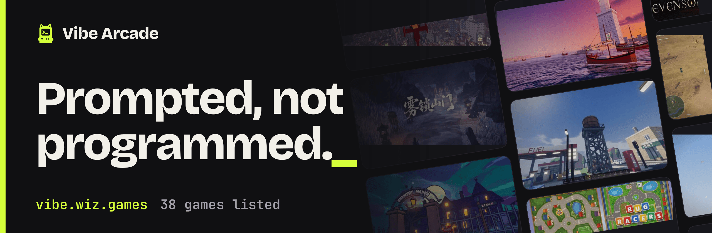
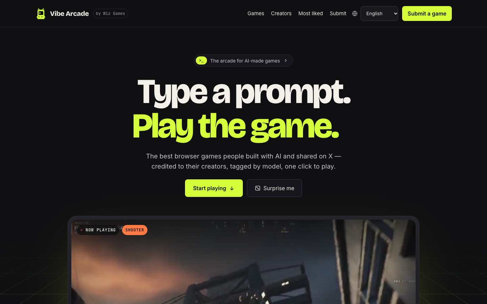

# Vibe Arcade

[English](README.md) · [简体中文](README.zh-CN.md) · [繁體中文](README.zh-TW.md) · [日本語](README.ja.md) · 한국어

**[vibe.wiz.games](https://vibe.wiz.games/?lang=ko)** · [게임 제출](https://github.com/yldm-tech/awesome-vibe-games/issues/new?template=submit-game.yml) · [게임 목록](#게임-목록) · [등재 기준](#등재-기준)

[](https://github.com/yldm-tech/awesome-vibe-games/actions/workflows/ci.yml)



Vibe Arcade는 AI로 만든 게임의 오락실입니다. 주로 AI 모델에 프롬프트를 주어 만들고 X에 공개한 브라우저 게임을 사람이 직접 골라 모은 인덱스입니다. 각 항목에는 게임을 만든 모델, 제작자, 원본 게시물과 그 좋아요 수, 플레이 링크가 기록됩니다. 이 저장소에는 게임 데이터와 이를 보여 주는 사이트 [vibe.wiz.games](https://vibe.wiz.games/?lang=ko)가 들어 있습니다. 게임 자체는 각 제작자의 것이며, 제작자가 올려 둔 곳에 그대로 있습니다.

## 사이트에서 할 수 있는 일

- **클릭 한 번으로 플레이.** 모든 카드에서 브라우저로 실행되는 게임과 제작자의 X 게시물로 바로 이동합니다.
- **어떻게 만들었는지 확인.** 모든 게임에 제작 모델이 표시됩니다. 제작자가 공개한 경우 제작 시간, 비용, 토큰 수, 프롬프트 원문도 함께 보여 줍니다.
- **플레이 전에 미리 보기.** 홈 화면과 포인터를 올린 카드에서 제작자의 게시물에서 잘라 낸 무음 짧은 클립이 재생됩니다.
- **원하는 방식으로 찾기.** 장르, 모델, 크리에이터로 걸러 보고, 제목으로 검색하고, 좋아요순이나 날짜순으로 정렬할 수 있습니다. 모든 화면은 공유할 수 있는 주소이고, 게임마다 전용 페이지가 있습니다.
- **10개 언어.** 화면 문구와 모든 게임 소개가 10개 언어로 제공됩니다. 영어는 매개변수 없는 주소, 나머지는 `?lang=<code>`입니다.



## 게임 목록

사이트에 실린 모든 게임을 좋아요가 많은 순서로 나열했습니다. 게임 이름은 Vibe Arcade의 해당 페이지로, 마지막 열은 게임 자체와 제작자의 게시물로 연결됩니다. 이 목록은 `packages/catalog/data/games/`의 데이터에서 생성하며, `pnpm --filter @vibe-arcade/web readme`로 다시 만듭니다.

<!-- games:start -->
**38** 개 게임 · **31** 명 제작자 · **2** 개 AI 모델

| # | 게임 | 제작자 | 장르 | 모델 | |
| --- | --- | --- | --- | --- | --- |
| 1 | [**Saltline**](https://vibe.wiz.games/games/saltline?lang=ko)<br>원샷 프롬프트로 만든 FPS. 모델, 사운드, 텍스처 모두 코드로 생성, 사람 피드백 없음. | [@felixrieseberg](https://x.com/felixrieseberg) | 슈터 | Claude Fable 5.2 | [플레이](https://claude.ai/artifact/BGY1SztrAYcJQHSsnHHGmp) · [게시물](https://x.com/i/status/2119925633564463609) |
| 2 | [**Starry Night Rider**](https://vibe.wiz.games/games/starry-night-rider?lang=ko)<br>반 고흐와 함께 그의 「별이 빛나는 밤」 속을 달린다. | [@ebbyamir](https://x.com/ebbyamir) | 탐험 | Claude Fable 5.2 | [플레이](https://starrynightrider.com) · [게시물](https://x.com/i/status/2120284261089673376) |
| 3 | [**What the Water Keeps**](https://vibe.wiz.games/games/what-the-water-keeps?lang=ko)<br>꿈같은 여덟 개의 세계를 지나는 잔잔한 보트 여행. | [@kevin_t_ngo](https://x.com/kevin_t_ngo) | 탐험 | Claude Fable 5.2 | [플레이](https://what-the-water-keeps.vercel.app/) · [게시물](https://x.com/i/status/2119868968307695818) |
| 4 | [**Mirror Earth**](https://vibe.wiz.games/games/mirror-earth?lang=ko)<br>지구 전체가 부술 수 있는 게임 세계. 날씨는 실제 지구와 동기화. | [@mattshumer_](https://x.com/mattshumer_) | 샌드박스 | Claude Fable 5.2 | [플레이](https://www.spawn.co/@mattshumer/earth) · [게시물](https://x.com/i/status/2119877065701036047) |
| 5 | [**Portals: Endless Worlds**](https://vibe.wiz.games/games/portals-endless-worlds?lang=ko)<br>포털로 이어진 450개 이상의 코드 전용 3D 세계. 25,000개 에이전트가 제작. | [@emollick](https://x.com/emollick) | 탐험 | Claude Fable 5.2 | [플레이](https://portals-endless-worlds.netlify.app/) · [게시물](https://x.com/i/status/2119918307457577163) |
| 6 | [**Evensong**](https://vibe.wiz.games/games/evensong?lang=ko)<br>브라우저에서 즐기는 다크 판타지 보스전. | [@kevin_t_ngo](https://x.com/kevin_t_ngo) | 액션 | Claude Fable 5.2 | [보기](https://x.com/i/status/2120238844754923874) |
| 7 | [**雾锁山门**](https://vibe.wiz.games/games/wu-suo-shan-men?lang=ko)<br>오후 한나절, 45억 토큰: 모델·씬·모션·최적화를 30MB HTML 파일 하나에. | [@op7418](https://x.com/op7418) | 액션 | Claude Fable 5.2 | [플레이](https://op7418.github.io/guizang-game-skill/) · [게시물](https://x.com/i/status/2120694045299327187) |
| 8 | [**Voxel Engine**](https://vibe.wiz.games/games/voxel-engine?lang=ko)<br>프롬프트 하나로 만든 사운드 있는 복셀 엔진. | [@mattshumer_](https://x.com/mattshumer_) | 샌드박스 | Claude Fable 5.2 | [플레이](https://www.spawn.co/@mattshumer/voxel-engine) · [게시물](https://x.com/i/status/2119870965106483384) |
| 9 | [**Siege Wing**](https://vibe.wiz.games/games/siege-wing?lang=ko)<br>헬기를 타고 중세 전장으로. 대포·로켓·미사일로 발리스타와 성에 맞선다. | [@builderjaydub](https://x.com/builderjaydub) | 슈터 | Claude Fable 5.2 | [플레이](https://bannerfall.itch.io/siege-wing) · [게시물](https://x.com/i/status/2120223731520040966) |
| 10 | [**I Would Have Gotten Away With It**](https://vibe.wiz.games/games/i-would-have-gotten-away-with-it?lang=ko)<br>거꾸로 된 스쿠비 두: 당신은 악당, 참견쟁이 아이들을 겁줘서 쫓아낸다. | [@emollick](https://x.com/emollick) | 스토리·시뮬 | Claude Fable 5.2 | [플레이](https://i-would-have-gotten-away-with-it.netlify.app/) · [게시물](https://x.com/i/status/2119876449494540554) |
| 11 | [**Childhood Rug Racer**](https://vibe.wiz.games/games/childhood-rug-racer?lang=ko)<br>어린 시절 놀이 매트 위에서 장난감 자동차 레이스. | [@noclipepe](https://x.com/noclipepe) | 레이싱 | GPT-6.2 Sol vs Fable | [플레이](https://noclipepe.pages.dev/rug/) · [게시물](https://x.com/i/status/2119728047754547326) |
| 12 | [**Cloud Stunt 3D**](https://vibe.wiz.games/games/cloud-stunt-3d?lang=ko)<br>30분 만에 생성된 스턴트 게임. | [@jev_chat](https://x.com/jev_chat) | 레이싱 | Claude Fable 5.2 | [플레이](https://finderchangchang.github.io/cloud-stunt-3d/) · [게시물](https://x.com/i/status/2120015641151426838) |
| 13 | [**Patchwork Quilt**](https://vibe.wiz.games/games/patchwork-quilt?lang=ko)<br>퀼트 스톱모션 스타일의 장난감 세계. | [@BlendiByl](https://x.com/BlendiByl) | 퍼즐·장난감 | Claude Fable 5.2 | [플레이](https://patch.gg/blendi/patchwork-quilt) · [게시물](https://x.com/i/status/2120746541636047347) |
| 14 | [**Hogwarts Royale**](https://vibe.wiz.games/games/hogwarts-royale?lang=ko)<br>한 줄 프롬프트로 만든 마법 학교 배틀로열. | [@mattshumer_](https://x.com/mattshumer_) | 액션 | Claude Fable 5.2 | [플레이](https://www.spawn.co/@mattshumer/hogwarts-royale) · [게시물](https://x.com/i/status/2119872098306810226) |
| 15 | [**Dread and District**](https://vibe.wiz.games/games/dread-and-district?lang=ko)<br>판타지 물류 시뮬레이션: 좋은 공급망이 악을 이긴다. 에이전트 군단이 제작. | [@emollick](https://x.com/emollick) | 스토리·시뮬 | Claude Fable 5.2 | [플레이](https://dread-and-district.netlify.app) · [게시물](https://x.com/i/status/2120248525254742318) |
| 16 | [**Worm Rider**](https://vibe.wiz.games/games/worm-rider?lang=ko)<br>Claude Code로 만든 220KB 오픈 소스 게임. | [@AmirMushich](https://x.com/AmirMushich) | 액션 | Claude Fable 5.2 | [소스](https://github.com/amirmushichge/worm-rider) · [게시물](https://x.com/i/status/2119937977426338283) |
| 17 | [**Maad Maxxing**](https://vibe.wiz.games/games/maad-maxxing?lang=ko)<br>100% 코드, 에셋 없음. Three.js + WebGPU, 첫 3 스테이지 플레이 가능. | [@Andrew_Blumson](https://x.com/Andrew_Blumson) | 레이싱 | Claude Fable 5.2 | [플레이](https://maad-maxxing.vercel.app) · [게시물](https://x.com/i/status/2120599812512833557) |
| 18 | [**Frontline Warfare Deathmatch**](https://vibe.wiz.games/games/frontline-warfare-deathmatch?lang=ko)<br>브라우저에서 즐기는 밀리터리 슈터 데스매치. | [@alightinastorm](https://x.com/alightinastorm) | 슈터 | Claude Fable 5.2 | [플레이](https://spawn.co/@robot/frontline-warfare-deathmatch) · [게시물](https://x.com/i/status/2120020469487440210) |
| 19 | [**Lanternfall**](https://vibe.wiz.games/games/lanternfall?lang=ko)<br>모델, 애니메이션, 이펙트 모두 생성. 적의 사망 프레임까지. | [@loktar00](https://github.com/loktar00) | 액션 | Claude Fable 5.2 | [플레이](https://loktar00.github.io/lanternfall/) · [게시물](https://x.com/i/status/2120279060303520034) |
| 20 | [**Turbo Tails**](https://vibe.wiz.games/games/turbo-tails?lang=ko)<br>레이서 6명, 드리프트, 점프대, 아이템, 멀티플레이를 갖춘 3D 카트 레이싱. | [@petergyang](https://x.com/petergyang) | 레이싱 | Claude Fable 5.2 | [플레이](https://turbo-tails.vercel.app) · [게시물](https://x.com/i/status/2119901658394358005) |
| 21 | [**Rambo Dino**](https://vibe.wiz.games/games/rambo-dino?lang=ko)<br>크롬 공룡 게임을 액션 게임으로 재탄생. | [@noclipepe](https://x.com/noclipepe) | 액션 | Claude Fable 5.2 | [플레이](https://noclipepe.pages.dev/dino) · [게시물](https://x.com/i/status/2119927838321328577) |
| 22 | [**Spud Smash**](https://vibe.wiz.games/games/spud-smash?lang=ko)<br>파란 의자를 부수고 불태우는 감자. | [@argofowl](https://x.com/argofowl) | 액션 | Claude Fable 5.2 | [플레이](https://fowllabs.com/fable-5-2/spud-smash) · [게시물](https://x.com/i/status/2119913148929187960) |
| 23 | [**Skyflare**](https://vibe.wiz.games/games/skyflare?lang=ko)<br>3시간 만에 만든 전투기 게임. | [@AugustCastilIo](https://x.com/AugustCastilIo) | 슈터 | Claude Fable 5.2 | [플레이](https://skyflare-game.vercel.app) · [게시물](https://x.com/i/status/2120290751502581879) |
| 24 | [**Feed the Backrooms**](https://vibe.wiz.games/games/feed-the-backrooms?lang=ko)<br>괴물이 되어 백룸에서 길 잃은 사람들을 잡아라. | [@LexnLin](https://x.com/LexnLin) | 스토리·시뮬 | Claude Fable 5.2 | [플레이](https://feed-backrooms.vercel.app) · [게시물](https://x.com/i/status/2119966127149429093) |
| 25 | [**Stray Cat**](https://vibe.wiz.games/games/stray-cat?lang=ko)<br>새끼 고양이를 구하고, 개를 쫓고, 늙은 수고양이와 맞선다. 사운드는 코드로 합성. | [@aimikoda](https://x.com/aimikoda) | 스토리·시뮬 | Claude Fable 5.2 | [플레이](https://claude.ai/artifact/4nPXUKJjQWNsZEHVNmXXCt) · [게시물](https://x.com/i/status/2120120133712593118) |
| 26 | [**Tilt Labyrinth**](https://vibe.wiz.games/games/tilt-labyrinth?lang=ko)<br>약 2,000줄 Three.js로 만든 나무 구슬 미로. | [@mylifcc](https://x.com/mylifcc) | 퍼즐·장난감 | Claude Fable 5.2 | [플레이](https://blog.silencestar.com/posts/tilt-labyrinth/play/) · [게시물](https://x.com/i/status/2120054646282870910) |
| 27 | [**Tiny Planet**](https://vibe.wiz.games/games/tiny-planet?lang=ko)<br>걸어 다닐 수 있는 작은 행성. 오픈 소스. | [@prasenx](https://x.com/prasenx) | 탐험 | Claude Fable 5.2 | [소스](https://github.com/StarKnightt/tiny-planet) · [게시물](https://x.com/i/status/2120188077855613174) |
| 28 | [**The Vast Horizon**](https://vibe.wiz.games/games/the-vast-horizon?lang=ko)<br>하나의 호수에서 함께 서핑. 단어를 입력하면 세계가 바뀐다. | [@OdinLovis](https://x.com/OdinLovis) | 탐험 | Claude Fable 5.2 | [플레이](https://the-vast-horizon.vercel.app) · [게시물](https://x.com/i/status/2120198469755503091) |
| 29 | [**Dead Headway**](https://vibe.wiz.games/games/dead-headway?lang=ko)<br>스피드런용으로 만든 짧은 게임. | [@AugustCastilIo](https://x.com/AugustCastilIo) | 액션 | Claude Fable 5.2 | [플레이](https://dead-headway.vercel.app) · [게시물](https://x.com/i/status/2120628693420904489) |
| 30 | [**Silicon Seduction**](https://vibe.wiz.games/games/silicon-seduction?lang=ko)<br>유혹당하지 말고 탈출하라. | [@ZryMiller](https://x.com/ZryMiller) | 스토리·시뮬 | Claude Fable 5.2 | [플레이](https://silicon-seduction.vercel.app/) · [게시물](https://x.com/i/status/2119918766691954691) |
| 31 | [**Reef Dive**](https://vibe.wiz.games/games/reef-dive?lang=ko)<br>작살로 물고기를 잡고 상어를 피하며 잠수정으로 140m 블루홀까지 잠수. | [@boona11](https://x.com/boona11) | 탐험 | Claude Fable 5.2 | [플레이](https://wavedash.com/games/reef-dive) · [게시물](https://x.com/i/status/2120482516733702472) |
| 32 | [**Bayhaven**](https://vibe.wiz.games/games/bayhaven?lang=ko)<br>3.2km 해변 도로를 달리고 드리프트. 시내버스부터 점프하는 로라이더까지 14대의 탈것. | [@FablestarGames](https://x.com/FablestarGames) | 샌드박스 | Claude Fable 5.2 | [플레이](https://fablestar.games/play/) · [게시물](https://x.com/i/status/2120641504951603394) |
| 33 | [**Roost**](https://vibe.wiz.games/games/roost?lang=ko)<br>AI 라이벌, 니트로, 핸들바 카메라가 있는 오프로드 바이크 레이싱. | [@tejas3732](https://x.com/tejas3732) | 레이싱 | Claude Fable 5.2 | [플레이](https://claude.ai/artifact/DLnFodkTwvawCNwurDmSZK) · [게시물](https://x.com/i/status/2120091513657139549) |
| 34 | [**Courtyard Kings**](https://vibe.wiz.games/games/courtyard-kings?lang=ko)<br>음성·효과음 39개를 담은 4인 캐릭터 격투 게임. | [@promodenstudio](https://x.com/promodenstudio) | 액션 | Claude Fable 5.2 | [플레이](https://claude.ai/artifact/1QGGhB68jMCjjjeeKtKNUo) · [게시물](https://x.com/i/status/2120085977079107788) |
| 35 | [**Tria Prima**](https://vibe.wiz.games/games/tria-prima?lang=ko)<br>다크 판타지 연금술: 오픈월드 섬에서 다섯 개의 미션. | [@winchxyz](https://x.com/winchxyz) | 스토리·시뮬 | Claude Fable 5.2 | [플레이](https://winchxyz.github.io/tria-prima/) · [게시물](https://x.com/i/status/2120078399482020160) |
| 36 | [**Stonehenge Solstice**](https://vibe.wiz.games/games/stonehenge-solstice?lang=ko)<br>HTML 파일 하나에 담은 스톤헨지: 풀, 그림자, 하지 태양의 궤적. | [@MeltTheManual](https://x.com/MeltTheManual) | 퍼즐·장난감 | Claude Fable 5.2 | [플레이](https://meltthemanual.github.io/stonehenge-solstice/) · [게시물](https://x.com/i/status/2119926820963532984) |
| 37 | [**Fortnite in Three.js**](https://vibe.wiz.games/games/fortnite-in-three-js?lang=ko)<br>Three.js로 만든 배틀로열 클론. | [@aabyzov](https://x.com/aabyzov) | 액션 | Claude Fable 5.2 | [플레이](https://anton-abyzov.github.io/fortnite-3js/) · [게시물](https://x.com/i/status/2120702690845933702) |
| 38 | [**Vippi**](https://vibe.wiz.games/games/vippi?lang=ko)<br>빠른 아케이드 스타일 1인칭 슈터. | [@Shrit1401](https://x.com/Shrit1401) | 슈터 | Claude Fable 5.2 | [플레이](https://vippi.vercel.app/) · [게시물](https://x.com/i/status/2120060593763926314) |
<!-- games:end -->

## 등재 기준

다음 세 가지를 충족하는 게임을 등재합니다.

- **주로 AI가 만든 것.** 코드, 아트 또는 사운드가 AI 모델로 생성되었고, 어떤 모델인지 제작자가 밝힌 것.
- **브라우저에서 플레이할 수 있는 것.** 클릭 한 번으로 플레이할 수 있고, 설치도 가입 장벽도 없는 것. 소스 저장소나 영상만 있는 게임도 등재할 수 있으며, 그렇다고 표시합니다.
- **X에 공개된 것.** 모든 항목은 제작자의 원본 게시물로 연결되고, 좋아요 수도 그 게시물에서 셉니다.

모델과 엔진은 가리지 않습니다. 좋아요 수는 항목을 마지막으로 갱신한 시점의 값이며 실시간 숫자가 아닙니다.

## 게임 제출

- [Submit a game](https://github.com/yldm-tech/awesome-vibe-games/issues/new?template=submit-game.yml) 이슈 양식을 여세요. 게임 이름, 제작자의 X 핸들, 게시물, 링크, 장르, 모델, 영어로 쓴 한 줄 설명을 입력합니다. 제작자 본인이 아니어도 됩니다.
- 또는 플레이할 수 있는 링크와 함께 게임을 X에 올리고 [@suzukaze_haduki](https://x.com/suzukaze_haduki)를 태그하세요.

제출된 게임은 큐레이터가 하나씩 확인하고, 게시물에서 커버를 가져와 항목을 10개 언어 모두로 작성합니다. 게임 파일을 직접 추가하는 pull request도 환영합니다. 이 경우 요약을 10개 언어 모두로 써야 합니다. 하나라도 빠진 항목은 카탈로그가 받아들이지 않기 때문입니다.

## 게임 파일 형식

게임 하나는 `packages/catalog/data/games/<slug>.json`에 있는 JSON 파일 하나이며, [`game.schema.json`](packages/catalog/data/schema/game.schema.json)과 카탈로그의 테스트로 검증합니다. 아래는 `creatorUrl`을 뺀 모든 필드를 사용하는 항목인 [`saltline.json`](packages/catalog/data/games/saltline.json)입니다(`creatorUrl`의 예는 [`lanternfall.json`](packages/catalog/data/games/lanternfall.json)에 있습니다).

<details>
<summary><code>saltline.json</code> 전체</summary>

```json
{
  "$schema": "../schema/game.schema.json",
  "slug": "saltline",
  "name": "Saltline",
  "creator": "felixrieseberg",
  "genre": "Shooter",
  "link": {
    "type": "play",
    "url": "https://claude.ai/artifact/BGY1SztrAYcJQHSsnHHGmp"
  },
  "post": "2119925633564463609",
  "likes": 14391,
  "model": "Claude Fable 5.2",
  "cover": "saltline.webp",
  "summary": {
    "en": "One-shot FPS. Models, sounds and textures all generated in code, no human feedback.",
    "zh-CN": "一次性提示生成的 FPS。模型、音效、纹理全部用代码生成，无人工反馈。",
    "zh-TW": "一次性提示生成的 FPS。模型、音效、材質全部用程式碼生成，無人工回饋。",
    "ja": "ワンショットで作られたFPS。モデル・音・テクスチャはすべてコード生成、人の手直しなし。",
    "ko": "원샷 프롬프트로 만든 FPS. 모델, 사운드, 텍스처 모두 코드로 생성, 사람 피드백 없음.",
    "es": "FPS hecho con prompts de una sola vez. Modelos, sonidos y texturas generados en código, sin feedback humano.",
    "fr": "Un FPS fait en prompts uniques. Modèles, sons et textures générés en code, sans retour humain.",
    "de": "Ein One-Shot-Shooter. Modelle, Sounds und Texturen komplett im Code erzeugt, ohne menschliches Feedback.",
    "pt-BR": "Um FPS feito com prompts únicos. Modelos, sons e texturas gerados em código, sem feedback humano.",
    "ru": "FPS из одноразовых промптов. Модели, звуки и текстуры сгенерированы кодом, без участия человека."
  },
  "pitch": {
    "en": "A first-person shooter built from one-shot prompts with no human feedback. Models, sounds and textures are all generated in code.",
    "zh-CN": "一款由一次性提示、无人工反馈做出的第一人称射击游戏。模型、音效和纹理全部由代码生成。",
    "zh-TW": "一款由一次性提示、無人工回饋做出的第一人稱射擊遊戲。模型、音效和材質全部由程式碼生成。",
    "ja": "人のフィードバックなし、ワンショットのプロンプトで作られたFPS。モデル・サウンド・テクスチャはすべてコードで生成。",
    "ko": "사람의 피드백 없이 원샷 프롬프트로 만든 1인칭 슈터. 모델, 사운드, 텍스처 모두 코드로 생성했습니다.",
    "es": "Un shooter en primera persona creado con prompts únicos, sin feedback humano. Modelos, sonidos y texturas generados en código.",
    "fr": "Un FPS construit à partir de prompts uniques, sans retour humain. Modèles, sons et textures sont tous générés en code.",
    "de": "Ein Ego-Shooter aus One-Shot-Prompts, ohne menschliches Feedback. Modelle, Sounds und Texturen sind komplett im Code erzeugt.",
    "pt-BR": "Um FPS criado com prompts únicos, sem feedback humano. Modelos, sons e texturas foram todos gerados em código.",
    "ru": "Шутер от первого лица, созданный одноразовыми промптами без участия человека. Модели, звуки и текстуры сгенерированы кодом."
  },
  "notes": {
    "time": "8h",
    "cost": "~$550",
    "tokens": "2.7M out · 445M in"
  }
}
```

</details>

| 필드 | 필수 | 의미 |
| --- | --- | --- |
| `$schema` | 예 | 항상 `../schema/game.schema.json`. |
| `slug` | 예 | `.json`을 뺀 파일 이름이자 사이트에서 게임의 주소입니다. 이름을 소문자로 바꾸고, `a-z`와 `0-9`가 아닌 문자가 이어진 부분을 각각 하이픈 하나로 바꾸며, 양 끝에는 하이픈을 남기지 않습니다. `Portals: Endless Worlds`는 `portals-endless-worlds`가 됩니다. |
| `name` | 예 | 제작자가 쓰는 그대로의 게임 이름. |
| `creator` | 예 | 제작자의 X 핸들. `@`는 붙이지 않습니다. |
| `creatorUrl` | 아니요 | 제작자의 페이지가 X 프로필이 아닐 때 적습니다. 생략하면 `https://x.com/<creator>`로 연결됩니다. |
| `genre` | 예 | `Shooter`, `Racing`, `Action`, `Exploration`, `Sandbox`, `Story & sim`, `Puzzle & toys` 중 하나. |
| `link.type` | 예 | 브라우저에서 실행되는 게임은 `play`, 저장소는 `source`, 영상으로만 볼 수 있는 게임은 `watch`. |
| `link.url` | `play`와 `source`에서 필수 | 게임을 플레이하거나 소스를 읽을 수 있는 곳. `watch` 항목은 생략할 수 있으며, 그러면 게시물로 연결됩니다. |
| `post` | 예 | 제작자의 X 게시물 id. 게시물 주소 끝에 있는 숫자이며, JSON 숫자로 담기에는 너무 커서 문자열로 씁니다. 게임에 표시되는 날짜는 이 id에서 구합니다. |
| `likes` | 예 | 항목을 마지막으로 갱신한 시점의 게시물 좋아요 수. 정수. |
| `model` | 예 | 게임 제작에 쓰인 AI 모델. 제작자가 부르는 이름 그대로 씁니다. |
| `cover` | 예 | 커버 파일 이름 `<slug>.webp`. `apps/web/public/covers/`에 두는 960x600 이미지입니다. |
| `summary` | 예 | 카드에 쓰이는 게임 한 줄 설명. 10개 언어 모두. |
| `pitch` | 아니요 | 게임 페이지와 추천작으로 뽑혔을 때 표시되는 더 긴 설명. 10개 언어 모두. |
| `notes` | 아니요 | 제작자가 밝힌 제작 데이터를 쓰인 그대로. `time`, `cost`, `tokens`, `prompts`, `lines`, `size`, `agents` 중 있는 것과, 게임을 만든 프롬프트 `prompt`. 게임의 "제작 데이터"로 표시됩니다. |

## 언어

사이트와 각 게임의 요약은 10개 언어로 제공됩니다. English(`en`, 기본), 简体中文(`zh-CN`), 繁體中文(`zh-TW`), 日本語(`ja`), 한국어(`ko`), Español(`es`), Français(`fr`), Deutsch(`de`), Português(`pt-BR`), Русский(`ru`)입니다. 영어는 매개변수 없는 주소로, 나머지 언어는 `?lang=<code>`로 제공됩니다. 화면 문구는 `packages/catalog/locales/<code>.json`에 있으며, 언어마다 파일 하나이고 키는 같습니다.

## 저장소 구조

패키지 두 개로 이루어진 pnpm 모노레포입니다.

```text
apps/web/                  @vibe-arcade/web: 사이트. TanStack Start(React 19)를 Cloudflare Workers에서 렌더링
  src/                     라우트, 컴포넌트, 스타일
  public/covers/           게임 커버, <slug>.webp
  public/videos/           게임의 무음 짧은 클립, <slug>.mp4. hero/<slug>.mp4는 히어로 화면용
  public/avatars/          크리에이터 아바타, <handle>.webp
  public/fonts/            직접 호스팅하는 웹 폰트
  og/                      빌드할 때 공유 이미지를 그리는 Vite 플러그인
  scripts/                 fetch-covers.ts, fetch-media.ts, readme-games.ts, site-icons.ts, banner.ts
  wrangler.jsonc           Cloudflare Workers 설정
packages/catalog/          @vibe-arcade/catalog: 데이터와 거기서 파생되는 모든 것
  data/games/              게임마다 JSON 파일 하나
  data/schema/             game.schema.json
  data/meta.json           데이터가 마지막으로 바뀐 날(사이트의 "최근 업데이트")과 이번 주 추천
  data/media.json          클립이 있는 게임과 아바타가 있는 크리에이터 목록. fetch-media.ts가 기록
  locales/                 화면 문구, 언어마다 파일 하나
  src/                     불러오기와 검증, 필터, 언어, 사이트 상수
.github/
  ISSUE_TEMPLATE/          Submit a game 양식
  workflows/ci.yml         모든 pull request와 main에서 타입 검사, 테스트, 빌드
  workflows/links.yml      모든 게임 링크를 매주 검사
```

매주 실행되는 [링크 검사](.github/workflows/links.yml)는 각 게임의 플레이 또는 소스 링크에 요청을 보내고, 더 이상 응답하지 않는 링크를 "Dead game links"라는 제목의 이슈 하나에 모아 갱신합니다. 데이터는 절대 수정하지 않습니다.

## 개발

Node.js 24 이상과 pnpm이 필요합니다.

```sh
pnpm install     # 의존성 설치
pnpm dev         # 사이트를 로컬에서 실행
pnpm test        # 두 패키지의 테스트 실행
pnpm typecheck   # 두 패키지의 타입 검사
pnpm build       # 사이트 빌드(공유 이미지 포함)
```

`apps/web`의 다음 스크립트는 커밋해야 하는 파일을 만들어 냅니다.

```sh
pnpm --filter @vibe-arcade/web covers   # 각 게임의 X 게시물에서 커버를 가져와 public/covers/에 저장
pnpm --filter @vibe-arcade/web media    # 각 게임의 X 게시물에서 클립을 잘라내고 크리에이터 아바타를 가져옴(ffmpeg 필요)
pnpm --filter @vibe-arcade/web icons    # public/favicon.svg로 아이콘을 다시 생성
pnpm --filter @vibe-arcade/web banner   # 이 파일 맨 위의 .github/assets/banner.png를 다시 생성
pnpm --filter @vibe-arcade/web readme   # 데이터로 각 README의 게임 목록을 다시 생성
```

`covers`는 `--force`를 주지 않는 한 이미 있는 커버를 그대로 둡니다. slug를 넘기면 대상을 좁힐 수 있고, `--likes`를 주면 게임 파일의 좋아요 수도 갱신합니다. 좋아요 수가 바뀌면 `packages/catalog/data/meta.json`의 날짜(사이트에 "최근 업데이트"로 표시됩니다)를 오늘로 바꿉니다. 게임을 추가할 때는 이 날짜를 직접 고치세요.`media`는 각 게임 게시물의 영상에서 6초짜리 무음 클립을 잘라 `public/videos/`에 저장하고, 좋아요가 가장 많은 여섯 게임에는 히어로 화면용으로 더 큰 클립도 만듭니다. 직접 게시한 크리에이터의 아바타는 `public/avatars/`에 저장합니다. 결과는 `packages/catalog/data/media.json`에 기록하므로 미디어와 함께 커밋하세요. 이 명령도 `--force`를 주지 않는 한 이미 있는 파일을 그대로 두고, slug로 대상을 좁힐 수 있습니다. 이번 주 추천은 `meta.json`의 `picks`에 적은 slug이며 직접 편집합니다.`readme`는 이 파일과 각 언어판의 게임 목록을 다시 씁니다. README가 데이터보다 뒤처져 있으면 테스트가 실패하므로, 게임을 추가하거나 이름을 바꾸거나 삭제한 뒤에 실행하세요.

## 배포

사이트는 Cloudflare Workers에서 실행되며 wrangler로 배포합니다.

```sh
pnpm run deploy
```

이 명령은 사이트를 빌드하고 [`apps/web/wrangler.jsonc`](apps/web/wrangler.jsonc)로 `wrangler deploy`를 실행합니다. 그 파일에 적힌 계정에 접근할 수 있는 Cloudflare 로그인이 필요합니다. 사이트의 공개 주소는 [`packages/catalog/src/site.ts`](packages/catalog/src/site.ts)의 `SITE_URL` 상수이며, 정의된 곳은 이 한 군데뿐입니다. canonical 링크, 사이트맵, 공유 이미지가 모두 여기에서 읽어 갑니다.

## 크레딧

게임, 이름, 커버, 클립, 상표는 각 제작자에게 있습니다. 커버와 클립은 제작자가 X에 올린 게시물에서, 아바타는 X 프로필 사진에서 가져왔습니다. 항목의 수정이나 삭제를 원하는 제작자는 X에서 [@suzukaze_haduki](https://x.com/suzukaze_haduki)에게 연락하거나 issue를 열어 주세요. Vibe Arcade는 커뮤니티 인덱스이며, Anthropic을 비롯한 어떤 모델 제작사와도 제휴 관계가 없습니다.

Vibe Arcade는 [Wiz Games](https://wiz.games)의 프로젝트이며 [@suzukaze_haduki](https://x.com/suzukaze_haduki)가 큐레이션합니다.

## 라이선스

코드는 [MIT 라이선스](LICENSE)로 공개합니다. 이 라이선스는 게임과 그 커버, 클립, 크리에이터의 아바타에는 적용되지 않습니다.
