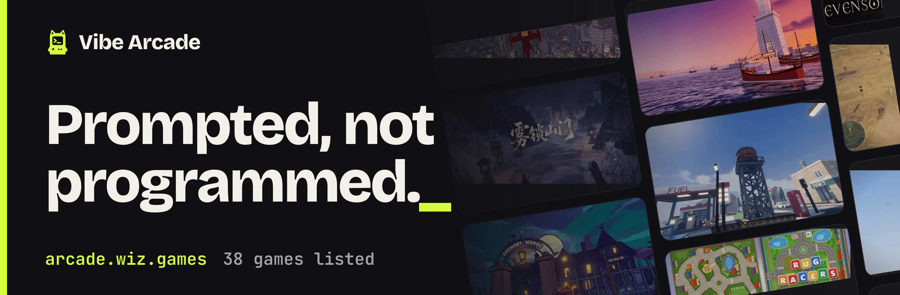

# Vibe Arcade

[English](README.md) · 简体中文 · [繁體中文](README.zh-TW.md) · [日本語](README.ja.md) · [한국어](README.ko.md)



Vibe Arcade 是一份人工整理的游戏索引，收录大家主要靠向 AI 模型下提示做出来、并发布在 X 上的游戏。每个条目记录制作游戏的模型、作者、原帖及其点赞数，以及游玩链接。这个仓库存放游戏数据和展示它们的网站；游戏本身仍属于各自的作者，托管在他们自己的地址上。

## 收录标准

满足以下三条的游戏会被收录：

- **主要由 AI 制作。** 代码、美术或音效由 AI 模型生成，并且作者说明了用的是哪个模型。
- **浏览器即玩。** 点一下就能玩，无需安装，也没有注册墙。只有源码仓库或视频的游戏也可以收录，会单独标注。
- **发布在 X 上。** 每个条目都链接到作者的原帖，点赞数也取自这条帖子。

不限模型，不限引擎。点赞数是条目上次更新时的快照，不是实时数字。

## 提交游戏

- 填写 [Submit a game](https://github.com/yldm-tech/awesome-vibe-games/issues/new?template=submit-game.yml) issue 表单。表单需要游戏名、作者的 X 账号、帖子、链接、类型、模型和一句英文简介。提交者不必是作者本人。
- 或者把游戏连同可玩的链接发到 X 上，并 @ [@suzukaze_haduki](https://x.com/suzukaze_haduki)。

每条提交都由策展人核对，封面取自帖子，条目的十种语言文本也由策展人撰写。也欢迎直接提 pull request 添加游戏文件；简介必须带齐十种语言，因为缺任何一种，目录都会拒绝这个条目。

## 游戏文件格式

每款游戏是一个 JSON 文件，位于 `packages/catalog/data/games/<slug>.json`，由 [`game.schema.json`](packages/catalog/data/schema/game.schema.json) 和目录的测试校验。下面是 [`saltline.json`](packages/catalog/data/games/saltline.json)，它用到了除 `creatorUrl` 之外的全部字段（`creatorUrl` 的用法见 [`lanternfall.json`](packages/catalog/data/games/lanternfall.json)）：

```json
{
  "$schema": "../schema/game.schema.json",
  "slug": "saltline",
  "name": "Saltline",
  "creator": "felixrieseberg",
  "genre": "Shooter",
  "link": {
    "type": "play",
    "url": "https://claude.ai/artifact/BGY1SztrAYcJQHSsnHHGmp"
  },
  "post": "2119925633564463609",
  "likes": 14391,
  "model": "Claude Fable 5.2",
  "cover": "saltline.webp",
  "summary": {
    "en": "One-shot FPS. Models, sounds and textures all generated in code, no human feedback.",
    "zh-CN": "一次性提示生成的 FPS。模型、音效、纹理全部用代码生成，无人工反馈。",
    "zh-TW": "一次性提示生成的 FPS。模型、音效、材質全部用程式碼生成，無人工回饋。",
    "ja": "ワンショットで作られたFPS。モデル・音・テクスチャはすべてコード生成、人の手直しなし。",
    "ko": "원샷 프롬프트로 만든 FPS. 모델, 사운드, 텍스처 모두 코드로 생성, 사람 피드백 없음.",
    "es": "FPS hecho con prompts de una sola vez. Modelos, sonidos y texturas generados en código, sin feedback humano.",
    "fr": "Un FPS fait en prompts uniques. Modèles, sons et textures générés en code, sans retour humain.",
    "de": "Ein One-Shot-Shooter. Modelle, Sounds und Texturen komplett im Code erzeugt, ohne menschliches Feedback.",
    "pt-BR": "Um FPS feito com prompts únicos. Modelos, sons e texturas gerados em código, sem feedback humano.",
    "ru": "FPS из одноразовых промптов. Модели, звуки и текстуры сгенерированы кодом, без участия человека."
  },
  "pitch": {
    "en": "A first-person shooter built from one-shot prompts with no human feedback. Models, sounds and textures are all generated in code.",
    "zh-CN": "一款由一次性提示、无人工反馈做出的第一人称射击游戏。模型、音效和纹理全部由代码生成。",
    "zh-TW": "一款由一次性提示、無人工回饋做出的第一人稱射擊遊戲。模型、音效和材質全部由程式碼生成。",
    "ja": "人のフィードバックなし、ワンショットのプロンプトで作られたFPS。モデル・サウンド・テクスチャはすべてコードで生成。",
    "ko": "사람의 피드백 없이 원샷 프롬프트로 만든 1인칭 슈터. 모델, 사운드, 텍스처 모두 코드로 생성했습니다.",
    "es": "Un shooter en primera persona creado con prompts únicos, sin feedback humano. Modelos, sonidos y texturas generados en código.",
    "fr": "Un FPS construit à partir de prompts uniques, sans retour humain. Modèles, sons et textures sont tous générés en code.",
    "de": "Ein Ego-Shooter aus One-Shot-Prompts, ohne menschliches Feedback. Modelle, Sounds und Texturen sind komplett im Code erzeugt.",
    "pt-BR": "Um FPS criado com prompts únicos, sem feedback humano. Modelos, sons e texturas foram todos gerados em código.",
    "ru": "Шутер от первого лица, созданный одноразовыми промптами без участия человека. Модели, звуки и текстуры сгенерированы кодом."
  },
  "featured": {
    "apiCost": "~$550",
    "buildTime": "8h",
    "outputTokens": 2700000
  }
}
```

| 字段 | 必填 | 含义 |
| --- | --- | --- |
| `$schema` | 是 | 固定为 `../schema/game.schema.json`。 |
| `slug` | 是 | 去掉 `.json` 的文件名，也是游戏在网站上的地址：名称转小写，每一段 `a-z`、`0-9` 以外的连续字符换成一个连字符，首尾不留连字符。`Portals: Endless Worlds` 对应 `portals-endless-worlds`。 |
| `name` | 是 | 游戏名，按作者的写法。 |
| `creator` | 是 | 作者的 X 账号，不带 `@`。 |
| `creatorUrl` | 否 | 作者主页不是其 X 主页时填写。不填则链接到 `https://x.com/<creator>`。 |
| `genre` | 是 | `Shooter`、`Racing`、`Action`、`Exploration`、`Sandbox`、`Story & sim`、`Puzzle & toys` 之一。 |
| `link.type` | 是 | `play` 表示能在浏览器里运行的游戏，`source` 表示源码仓库，`watch` 表示只能在视频里看到的游戏。 |
| `link.url` | `play` 和 `source` 必填 | 游玩地址或源码地址。`watch` 条目可以不填，此时链接到帖子。 |
| `post` | 是 | 作者在 X 上的帖子 id，即帖子地址末尾的那串数字，写成字符串，因为它超出了 JSON 数字能表示的范围。游戏显示的日期从这个 id 算出。 |
| `likes` | 是 | 条目上次更新时帖子的点赞数，整数。 |
| `model` | 是 | 制作游戏所用的 AI 模型，按作者的叫法。 |
| `cover` | 是 | 封面文件名 `<slug>.webp`：一张 960x600 的图片，放在 `apps/web/public/covers/`。 |
| `summary` | 是 | 卡片上的一句话简介，十种语言齐全。 |
| `pitch` | 否 | 游戏被推荐时显示的较长介绍，十种语言齐全。 |
| `featured` | 否 | 作者公布的 `apiCost`、`buildTime` 和 `outputTokens`。带这个字段的游戏就是首页的推荐游戏，所以有且只有一款游戏带它。 |

## 语言

网站和每款游戏的简介都有十种语言：English（`en`，默认）、简体中文（`zh-CN`）、繁體中文（`zh-TW`）、日本語（`ja`）、한국어（`ko`）、Español（`es`）、Français（`fr`）、Deutsch（`de`）、Português（`pt-BR`）和 Русский（`ru`）。英文使用不带参数的地址，其他语言使用 `?lang=<code>`。界面文案在 `packages/catalog/locales/<code>.json`，每种语言一个文件，键相同。

## 仓库结构

一个 pnpm monorepo，包含两个包：

```text
apps/web/                  @vibe-arcade/web：网站，TanStack Start（React 19），在 Cloudflare Workers 上渲染
  src/                     路由、组件和样式
  public/covers/           游戏封面，<slug>.webp
  public/fonts/            自托管的网页字体
  og/                      在构建时绘制分享图的 Vite 插件
  scripts/                 fetch-covers.ts、site-icons.ts、banner.ts
  wrangler.jsonc           Cloudflare Workers 配置
packages/catalog/          @vibe-arcade/catalog：数据以及由它派生的一切
  data/games/              每款游戏一个 JSON 文件
  data/schema/             game.schema.json
  data/meta.json           数据最后变更的日期，即站点上的“最近更新”
  locales/                 界面文案，每种语言一个文件
  src/                     加载与校验、筛选、语言、站点常量
.github/
  ISSUE_TEMPLATE/          Submit a game 表单
  workflows/ci.yml         在每个 pull request 和 main 上做类型检查、测试和构建
  workflows/links.yml      每周检查所有游戏链接
```

每周的[链接检查](.github/workflows/links.yml)会请求每款游戏的游玩或源码链接，并维护一个标题为“Dead game links”的 issue，列出不再响应的链接。它从不修改数据。

## 开发

需要 Node.js 24 或更高版本，以及 pnpm。

```sh
pnpm install     # 安装依赖
pnpm dev         # 在本地运行网站
pnpm test        # 运行两个包的测试
pnpm typecheck   # 对两个包做类型检查
pnpm build       # 构建网站，包括分享图
```

`apps/web` 里有三个脚本，它们写出的文件需要提交：

```sh
pnpm --filter @vibe-arcade/web covers   # 从每款游戏的 X 帖子抓取封面到 public/covers/
pnpm --filter @vibe-arcade/web icons    # 根据 public/favicon.svg 重新生成图标
pnpm --filter @vibe-arcade/web banner   # 重新生成本文件顶部的 .github/assets/banner.png
```

`covers` 会保留已存在的封面，除非加上 `--force`；可以传入 slug 来限定范围；加上 `--likes` 还会刷新游戏文件里的点赞数；只要有点赞数变化，它就把 `packages/catalog/data/meta.json` 里的日期（站点上显示的“最近更新”）改成当天。添加游戏时，这个日期需要手动修改。

## 部署

网站运行在 Cloudflare Workers 上，用 wrangler 部署：

```sh
pnpm run deploy
```

这条命令会构建网站，并按 [`apps/web/wrangler.jsonc`](apps/web/wrangler.jsonc) 执行 `wrangler deploy`；需要登录 Cloudflare，并有权访问其中指定的账号。网站的公开地址是 [`packages/catalog/src/site.ts`](packages/catalog/src/site.ts) 里的 `SITE_URL` 常量，只在这一处定义：canonical 链接、站点地图和分享图都从那里读取。

## 致谢

游戏、名称、封面和商标归各自的作者所有。封面是作者在 X 上所发帖子里的画面。Vibe Arcade 是一份社区索引，与 Anthropic 或其他任何模型厂商均无关联。

Vibe Arcade 是 [Wiz Games](https://wiz.games) 的项目，由 [@suzukaze_haduki](https://x.com/suzukaze_haduki) 策展。

## 许可证

代码以 [MIT 许可证](LICENSE)发布。该许可证不涵盖游戏及其封面。
