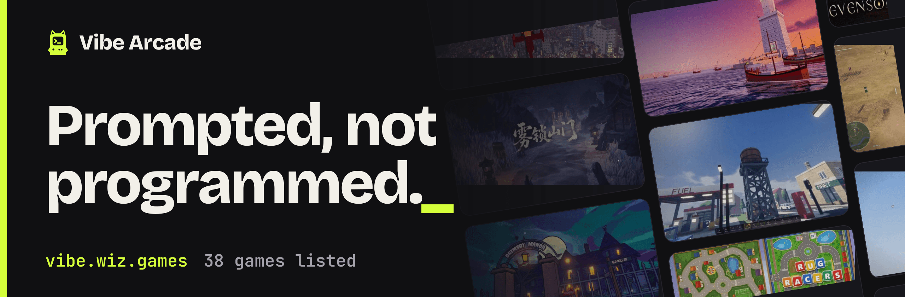
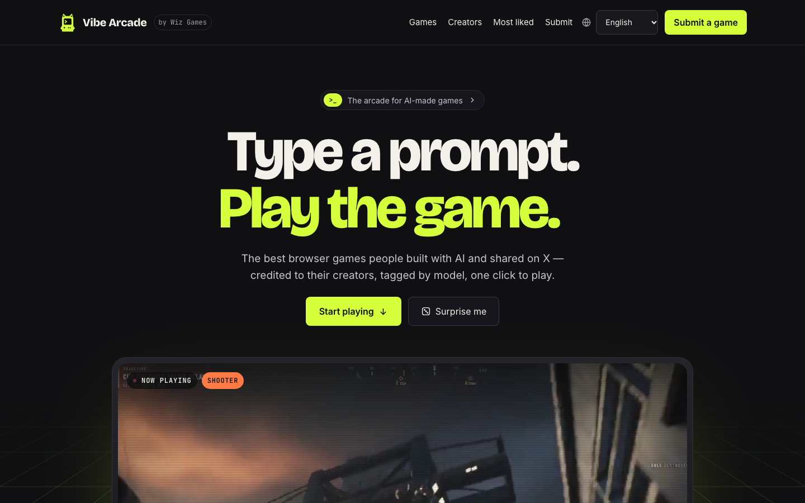

# Vibe Arcade

[English](README.md) · [简体中文](README.zh-CN.md) · 繁體中文 · [日本語](README.ja.md) · [한국어](README.ko.md)

**[vibe.wiz.games](https://vibe.wiz.games/?lang=zh-TW)** · [提交遊戲](https://github.com/yldm-tech/awesome-vibe-games/issues/new?template=submit-game.yml) · [遊戲列表](#遊戲列表) · [收錄標準](#收錄標準)

[](https://github.com/yldm-tech/awesome-vibe-games/actions/workflows/ci.yml)



Vibe Arcade 是 AI 遊戲的街機廳：一份人工整理的瀏覽器遊戲索引，收錄大家主要靠向 AI 模型下提示做出來、並發布在 X 上的遊戲。每個條目記錄製作遊戲的模型、作者、原始貼文及其按讚數，以及遊玩連結。這個儲存庫存放遊戲資料和展示它們的網站 [vibe.wiz.games](https://vibe.wiz.games/?lang=zh-TW)；遊戲本身仍屬於各自的作者，託管在他們自己的位址上。

## 網站上有什麼

- **一鍵開玩。** 每張卡片都直接連結到瀏覽器裡的遊戲，以及作者在 X 上的原始貼文。
- **看它是怎麼做出來的。** 每款遊戲都標註了製作模型；作者公布過的話，還有製作時間、花費、token 數和提示詞原文。
- **先看再玩。** 首屏和滑鼠停留的卡片會播放取自作者貼文的無聲短片。
- **用自己的方式找遊戲。** 依類型、模型或創作者篩選，依標題搜尋，依按讚數或日期排序。每個檢視都是可以分享的網址，每款遊戲也有自己的頁面。
- **十種語言。** 介面和每款遊戲的簡介都有十種語言，英語在不帶參數的網址，其餘語言在 `?lang=<code>`。



## 遊戲列表

網站上的全部遊戲，依按讚數由高到低排列。遊戲名稱連結到它在 Vibe Arcade 上的頁面，最後一欄連結到遊戲本身和作者的原始貼文。這份列表由 `packages/catalog/data/games/` 裡的資料產生，用 `pnpm --filter @vibe-arcade/web readme` 重新產生。

<!-- games:start -->
| 遊戲 | 作者 | 類型 | 模型 | |
| --- | --- | --- | --- | --- |
| [**Starry Night Rider**](https://vibe.wiz.games/games/starry-night-rider?lang=zh-TW)<br>跟著梵谷騎行穿越他的《星夜》。 | [@ebbyamir](https://x.com/ebbyamir) | 探索 | Claude Fable 5.2 | [遊玩](https://starrynightrider.com) · [原文](https://x.com/i/status/2120284261089673376) |
| [**Saltline**](https://vibe.wiz.games/games/saltline?lang=zh-TW)<br>一次性提示生成的 FPS。模型、音效、材質全部用程式碼生成，無人工回饋。 | [@felixrieseberg](https://x.com/felixrieseberg) | 射擊 | Claude Fable 5.2 | [遊玩](https://claude.ai/artifact/BGY1SztrAYcJQHSsnHHGmp) · [原文](https://x.com/i/status/2119925633564463609) |
| [**What the Water Keeps**](https://vibe.wiz.games/games/what-the-water-keeps?lang=zh-TW)<br>平靜的小船之旅，穿越八個夢境般的世界。 | [@kevin_t_ngo](https://x.com/kevin_t_ngo) | 探索 | Claude Fable 5.2 | [遊玩](https://what-the-water-keeps.vercel.app/) · [原文](https://x.com/i/status/2119868968307695818) |
| [**Mirror Earth**](https://vibe.wiz.games/games/mirror-earth?lang=zh-TW)<br>整個地球都是可破壞的遊戲世界，天氣與真實地球同步。 | [@mattshumer_](https://x.com/mattshumer_) | 沙盒 | Claude Fable 5.2 | [遊玩](https://www.spawn.co/@mattshumer/earth) · [原文](https://x.com/i/status/2119877065701036047) |
| [**Portals: Endless Worlds**](https://vibe.wiz.games/games/portals-endless-worlds?lang=zh-TW)<br>450+ 個純程式碼 3D 世界由傳送門相連，由 25,000 個代理建造。 | [@emollick](https://x.com/emollick) | 探索 | Claude Fable 5.2 | [遊玩](https://portals-endless-worlds.netlify.app/) · [原文](https://x.com/i/status/2119918307457577163) |
| [**Evensong**](https://vibe.wiz.games/games/evensong?lang=zh-TW)<br>黑暗奇幻 Boss 戰，可在瀏覽器中遊玩。 | [@kevin_t_ngo](https://x.com/kevin_t_ngo) | 動作 | Claude Fable 5.2 | [觀看](https://x.com/i/status/2120238844754923874) |
| [**雾锁山门**](https://vibe.wiz.games/games/wu-suo-shan-men?lang=zh-TW)<br>一個下午、45 億 token：模型、場景、動作和最佳化全塞進一個 30 MB 的 HTML 檔。 | [@op7418](https://x.com/op7418) | 動作 | Claude Fable 5.2 | [遊玩](https://op7418.github.io/guizang-game-skill/) · [原文](https://x.com/i/status/2120694045299327187) |
| [**Voxel Engine**](https://vibe.wiz.games/games/voxel-engine?lang=zh-TW)<br>帶音效的體素引擎，一句提示生成。 | [@mattshumer_](https://x.com/mattshumer_) | 沙盒 | Claude Fable 5.2 | [遊玩](https://www.spawn.co/@mattshumer/voxel-engine) · [原文](https://x.com/i/status/2119870965106483384) |
| [**Siege Wing**](https://vibe.wiz.games/games/siege-wing?lang=zh-TW)<br>駕駛直升機闖入中世紀戰場，用加農砲、火箭和飛彈對抗弩砲與城堡。 | [@builderjaydub](https://x.com/builderjaydub) | 射擊 | Claude Fable 5.2 | [遊玩](https://bannerfall.itch.io/siege-wing) · [原文](https://x.com/i/status/2120223731520040966) |
| [**Patchwork Quilt**](https://vibe.wiz.games/games/patchwork-quilt?lang=zh-TW)<br>拼布定格動畫風格的玩具世界。 | [@BlendiByl](https://x.com/BlendiByl) | 解謎與玩具 | Claude Fable 5.2 | [遊玩](https://patch.gg/blendi/patchwork-quilt) · [原文](https://x.com/i/status/2120746541636047347) |
| [**I Would Have Gotten Away With It**](https://vibe.wiz.games/games/i-would-have-gotten-away-with-it?lang=zh-TW)<br>反向《史酷比》：你是反派，負責嚇跑那群多管閒事的孩子。 | [@emollick](https://x.com/emollick) | 劇情與模擬 | Claude Fable 5.2 | [遊玩](https://i-would-have-gotten-away-with-it.netlify.app/) · [原文](https://x.com/i/status/2119876449494540554) |
| [**Childhood Rug Racer**](https://vibe.wiz.games/games/childhood-rug-racer?lang=zh-TW)<br>在童年的遊戲地毯上開玩具車賽跑。 | [@noclipepe](https://x.com/noclipepe) | 競速 | GPT-6.2 Sol vs Fable | [遊玩](https://noclipepe.pages.dev/rug/) · [原文](https://x.com/i/status/2119728047754547326) |
| [**Cloud Stunt 3D**](https://vibe.wiz.games/games/cloud-stunt-3d?lang=zh-TW)<br>30 分鐘生成的特技遊戲。 | [@jev_chat](https://x.com/jev_chat) | 競速 | Claude Fable 5.2 | [遊玩](https://finderchangchang.github.io/cloud-stunt-3d/) · [原文](https://x.com/i/status/2120015641151426838) |
| [**Hogwarts Royale**](https://vibe.wiz.games/games/hogwarts-royale?lang=zh-TW)<br>一句提示生成的魔法學院大逃殺。 | [@mattshumer_](https://x.com/mattshumer_) | 動作 | Claude Fable 5.2 | [遊玩](https://www.spawn.co/@mattshumer/hogwarts-royale) · [原文](https://x.com/i/status/2119872098306810226) |
| [**Dread and District**](https://vibe.wiz.games/games/dread-and-district?lang=zh-TW)<br>奇幻物流模擬：好的供應鏈打敗邪惡。由一群代理協作完成。 | [@emollick](https://x.com/emollick) | 劇情與模擬 | Claude Fable 5.2 | [遊玩](https://dread-and-district.netlify.app) · [原文](https://x.com/i/status/2120248525254742318) |
| [**Worm Rider**](https://vibe.wiz.games/games/worm-rider?lang=zh-TW)<br>用 Claude Code 打造的 220 KB 開源遊戲。 | [@AmirMushich](https://x.com/AmirMushich) | 動作 | Claude Fable 5.2 | [原始碼](https://github.com/amirmushichge/worm-rider) · [原文](https://x.com/i/status/2119937977426338283) |
| [**Maad Maxxing**](https://vibe.wiz.games/games/maad-maxxing?lang=zh-TW)<br>100% 程式碼，零素材。Three.js + WebGPU，前 3 關可玩。 | [@Andrew_Blumson](https://x.com/Andrew_Blumson) | 競速 | Claude Fable 5.2 | [遊玩](https://maad-maxxing.vercel.app) · [原文](https://x.com/i/status/2120599812512833557) |
| [**Frontline Warfare Deathmatch**](https://vibe.wiz.games/games/frontline-warfare-deathmatch?lang=zh-TW)<br>瀏覽器裡的軍事射擊死鬥。 | [@alightinastorm](https://x.com/alightinastorm) | 射擊 | Claude Fable 5.2 | [遊玩](https://spawn.co/@robot/frontline-warfare-deathmatch) · [原文](https://x.com/i/status/2120020469487440210) |
| [**Lanternfall**](https://vibe.wiz.games/games/lanternfall?lang=zh-TW)<br>模型、動畫、特效全部生成，連敵人死亡影格都不放過。 | [@loktar00](https://github.com/loktar00) | 動作 | Claude Fable 5.2 | [遊玩](https://loktar00.github.io/lanternfall/) · [原文](https://x.com/i/status/2120279060303520034) |
| [**Rambo Dino**](https://vibe.wiz.games/games/rambo-dino?lang=zh-TW)<br>Chrome 小恐龍遊戲，改造成動作遊戲。 | [@noclipepe](https://x.com/noclipepe) | 動作 | Claude Fable 5.2 | [遊玩](https://noclipepe.pages.dev/dino) · [原文](https://x.com/i/status/2119927838321328577) |
| [**Turbo Tails**](https://vibe.wiz.games/games/turbo-tails?lang=zh-TW)<br>3D 卡丁車：六名車手、甩尾、跳台、道具，支援多人。 | [@petergyang](https://x.com/petergyang) | 競速 | Claude Fable 5.2 | [遊玩](https://turbo-tails.vercel.app) · [原文](https://x.com/i/status/2119901658394358005) |
| [**Spud Smash**](https://vibe.wiz.games/games/spud-smash?lang=zh-TW)<br>一顆馬鈴薯，砸爛並燒掉藍色椅子。 | [@argofowl](https://x.com/argofowl) | 動作 | Claude Fable 5.2 | [遊玩](https://fowllabs.com/fable-5-2/spud-smash) · [原文](https://x.com/i/status/2119913148929187960) |
| [**Skyflare**](https://vibe.wiz.games/games/skyflare?lang=zh-TW)<br>三小時做出來的戰鬥機遊戲。 | [@AugustCastilIo](https://x.com/AugustCastilIo) | 射擊 | Claude Fable 5.2 | [遊玩](https://skyflare-game.vercel.app) · [原文](https://x.com/i/status/2120290751502581879) |
| [**Feed the Backrooms**](https://vibe.wiz.games/games/feed-the-backrooms?lang=zh-TW)<br>扮演怪物，抓捕迷失在後室的人。 | [@LexnLin](https://x.com/LexnLin) | 劇情與模擬 | Claude Fable 5.2 | [遊玩](https://feed-backrooms.vercel.app) · [原文](https://x.com/i/status/2119966127149429093) |
| [**Stray Cat**](https://vibe.wiz.games/games/stray-cat?lang=zh-TW)<br>救小貓、嚇跑狗、直面老公貓。音效由程式碼合成。 | [@aimikoda](https://x.com/aimikoda) | 劇情與模擬 | Claude Fable 5.2 | [遊玩](https://claude.ai/artifact/4nPXUKJjQWNsZEHVNmXXCt) · [原文](https://x.com/i/status/2120120133712593118) |
| [**Tilt Labyrinth**](https://vibe.wiz.games/games/tilt-labyrinth?lang=zh-TW)<br>約 2,000 行 Three.js 寫成的木製滾珠迷宮。 | [@mylifcc](https://x.com/mylifcc) | 解謎與玩具 | Claude Fable 5.2 | [遊玩](https://blog.silencestar.com/posts/tilt-labyrinth/play/) · [原文](https://x.com/i/status/2120054646282870910) |
| [**Tiny Planet**](https://vibe.wiz.games/games/tiny-planet?lang=zh-TW)<br>一顆可以四處走動的小星球。開源。 | [@prasenx](https://x.com/prasenx) | 探索 | Claude Fable 5.2 | [原始碼](https://github.com/StarKnightt/tiny-planet) · [原文](https://x.com/i/status/2120188077855613174) |
| [**The Vast Horizon**](https://vibe.wiz.games/games/the-vast-horizon?lang=zh-TW)<br>多人共享一片湖衝浪。輸入一個詞，世界就隨之改變。 | [@OdinLovis](https://x.com/OdinLovis) | 探索 | Claude Fable 5.2 | [遊玩](https://the-vast-horizon.vercel.app) · [原文](https://x.com/i/status/2120198469755503091) |
| [**Dead Headway**](https://vibe.wiz.games/games/dead-headway?lang=zh-TW)<br>專為速通打造的小遊戲。 | [@AugustCastilIo](https://x.com/AugustCastilIo) | 動作 | Claude Fable 5.2 | [遊玩](https://dead-headway.vercel.app) · [原文](https://x.com/i/status/2120628693420904489) |
| [**Silicon Seduction**](https://vibe.wiz.games/games/silicon-seduction?lang=zh-TW)<br>逃出去，別被誘惑。 | [@ZryMiller](https://x.com/ZryMiller) | 劇情與模擬 | Claude Fable 5.2 | [遊玩](https://silicon-seduction.vercel.app/) · [原文](https://x.com/i/status/2119918766691954691) |
| [**Reef Dive**](https://vibe.wiz.games/games/reef-dive?lang=zh-TW)<br>用魚叉捕魚、閃避鯊魚、駕駛潛艇，下潛 140 公尺直達藍洞。 | [@boona11](https://x.com/boona11) | 探索 | Claude Fable 5.2 | [遊玩](https://wavedash.com/games/reef-dive) · [原文](https://x.com/i/status/2120482516733702472) |
| [**Bayhaven**](https://vibe.wiz.games/games/bayhaven?lang=zh-TW)<br>在 3.2 公里的海濱開車甩尾，14 種載具，從市區公車到會跳的低底盤車。 | [@FablestarGames](https://x.com/FablestarGames) | 沙盒 | Claude Fable 5.2 | [遊玩](https://fablestar.games/play/) · [原文](https://x.com/i/status/2120641504951603394) |
| [**Roost**](https://vibe.wiz.games/games/roost?lang=zh-TW)<br>越野機車賽車：AI 對手、氮氣加速、車把視角。 | [@tejas3732](https://x.com/tejas3732) | 競速 | Claude Fable 5.2 | [遊玩](https://claude.ai/artifact/DLnFodkTwvawCNwurDmSZK) · [原文](https://x.com/i/status/2120091513657139549) |
| [**Courtyard Kings**](https://vibe.wiz.games/games/courtyard-kings?lang=zh-TW)<br>四角色格鬥遊戲，含 39 段語音與音效。 | [@promodenstudio](https://x.com/promodenstudio) | 動作 | Claude Fable 5.2 | [遊玩](https://claude.ai/artifact/1QGGhB68jMCjjjeeKtKNUo) · [原文](https://x.com/i/status/2120085977079107788) |
| [**Tria Prima**](https://vibe.wiz.games/games/tria-prima?lang=zh-TW)<br>黑暗奇幻鍊金術：開放世界島嶼上的五個任務。 | [@winchxyz](https://x.com/winchxyz) | 劇情與模擬 | Claude Fable 5.2 | [遊玩](https://winchxyz.github.io/tria-prima/) · [原文](https://x.com/i/status/2120078399482020160) |
| [**Stonehenge Solstice**](https://vibe.wiz.games/games/stonehenge-solstice?lang=zh-TW)<br>一個 HTML 檔裡的巨石陣：草地、陰影與夏至太陽軌跡。 | [@MeltTheManual](https://x.com/MeltTheManual) | 解謎與玩具 | Claude Fable 5.2 | [遊玩](https://meltthemanual.github.io/stonehenge-solstice/) · [原文](https://x.com/i/status/2119926820963532984) |
| [**Fortnite in Three.js**](https://vibe.wiz.games/games/fortnite-in-three-js?lang=zh-TW)<br>用 Three.js 復刻的大逃殺。 | [@aabyzov](https://x.com/aabyzov) | 動作 | Claude Fable 5.2 | [遊玩](https://anton-abyzov.github.io/fortnite-3js/) · [原文](https://x.com/i/status/2120702690845933702) |
| [**Vippi**](https://vibe.wiz.games/games/vippi?lang=zh-TW)<br>快節奏街機風格第一人稱射擊。 | [@Shrit1401](https://x.com/Shrit1401) | 射擊 | Claude Fable 5.2 | [遊玩](https://vippi.vercel.app/) · [原文](https://x.com/i/status/2120060593763926314) |
| [**Wave Rider Nusantara**](https://vibe.wiz.games/games/wave-rider-nusantara?lang=zh-TW)<br>受印尼群島的文化與視覺風格啟發的街機風格遊戲。 | [@abusofianid](https://x.com/abusofianid) | 探索 | Gemini + ChatGPT | [原始碼](https://github.com/abusofianid/game-wave-rider-nusantara) · [原文](https://x.com/i/status/2121088313658572857) |
<!-- games:end -->

## 收錄標準

符合以下三項的遊戲會被收錄：

- **主要由 AI 製作。** 程式碼、美術或音效由 AI 模型生成，而且作者說明了用的是哪個模型。
- **瀏覽器即玩。** 點一下就能玩，不必安裝，也沒有註冊牆。只有原始碼儲存庫或影片的遊戲也可以收錄，會另外標示。
- **發布在 X 上。** 每個條目都連結到作者的原始貼文，按讚數也取自這則貼文。

不限模型，不限引擎。按讚數是條目上次更新時的快照，不是即時數字。

## 提交遊戲

- 填寫 [Submit a game](https://github.com/yldm-tech/awesome-vibe-games/issues/new?template=submit-game.yml) issue 表單。表單需要遊戲名稱、作者的 X 帳號、貼文、連結、類型、模型和一句英文簡介。提交者不必是作者本人。
- 或者把遊戲連同可玩的連結發到 X 上，並標記 [@suzukaze_haduki](https://x.com/suzukaze_haduki)。

[投稿工作流程](.github/workflows/submissions.yml)會在幾分鐘內自動上架遊戲，全程無人值守。它會檢查貼文是否存在、是否由作者本人發布，遊玩或原始碼連結能否開啟，遊戲是否已收錄；然後從貼文取封面、短片和作者頭像，開一個關閉該 issue 的 PR，CI 通過後自動合併並部署網站。如果有問題，它會在 issue 裡說明，編輯 issue 就會重試。簡介先以英文上線，其他語言在翻譯前顯示英文。也歡迎直接發 pull request 新增遊戲檔案。註冊未滿七天的 GitHub 帳號、已有三份投稿待處理的提交者，以及[封鎖名單](.github/submission-blocklist.txt)上的人，都不會被自動收錄。儲存庫設定了模型 API key（`EVERYAPI_API_KEY`）時，機器人還會把簡介翻譯成另外九種語言，並拒絕明顯是垃圾或惡意內容的投稿。

## 遊戲檔案格式

每款遊戲是一個 JSON 檔案，位於 `packages/catalog/data/games/<slug>.json`，由 [`game.schema.json`](packages/catalog/data/schema/game.schema.json) 和目錄的測試驗證。以下是 [`saltline.json`](packages/catalog/data/games/saltline.json)，它用到了除 `creatorUrl` 之外的全部欄位（`creatorUrl` 的用法見 [`lanternfall.json`](packages/catalog/data/games/lanternfall.json)）：

<details>
<summary><code>saltline.json</code> 的完整內容</summary>

```json
{
  "$schema": "../schema/game.schema.json",
  "slug": "saltline",
  "name": "Saltline",
  "creator": "felixrieseberg",
  "genre": "Shooter",
  "link": {
    "type": "play",
    "url": "https://claude.ai/artifact/BGY1SztrAYcJQHSsnHHGmp"
  },
  "post": "2119925633564463609",
  "likes": 14391,
  "model": "Claude Fable 5.2",
  "cover": "saltline.webp",
  "summary": {
    "en": "One-shot FPS. Models, sounds and textures all generated in code, no human feedback.",
    "zh-CN": "一次性提示生成的 FPS。模型、音效、纹理全部用代码生成，无人工反馈。",
    "zh-TW": "一次性提示生成的 FPS。模型、音效、材質全部用程式碼生成，無人工回饋。",
    "ja": "ワンショットで作られたFPS。モデル・音・テクスチャはすべてコード生成、人の手直しなし。",
    "ko": "원샷 프롬프트로 만든 FPS. 모델, 사운드, 텍스처 모두 코드로 생성, 사람 피드백 없음.",
    "es": "FPS hecho con prompts de una sola vez. Modelos, sonidos y texturas generados en código, sin feedback humano.",
    "fr": "Un FPS fait en prompts uniques. Modèles, sons et textures générés en code, sans retour humain.",
    "de": "Ein One-Shot-Shooter. Modelle, Sounds und Texturen komplett im Code erzeugt, ohne menschliches Feedback.",
    "pt-BR": "Um FPS feito com prompts únicos. Modelos, sons e texturas gerados em código, sem feedback humano.",
    "ru": "FPS из одноразовых промптов. Модели, звуки и текстуры сгенерированы кодом, без участия человека."
  },
  "pitch": {
    "en": "A first-person shooter built from one-shot prompts with no human feedback. Models, sounds and textures are all generated in code.",
    "zh-CN": "一款由一次性提示、无人工反馈做出的第一人称射击游戏。模型、音效和纹理全部由代码生成。",
    "zh-TW": "一款由一次性提示、無人工回饋做出的第一人稱射擊遊戲。模型、音效和材質全部由程式碼生成。",
    "ja": "人のフィードバックなし、ワンショットのプロンプトで作られたFPS。モデル・サウンド・テクスチャはすべてコードで生成。",
    "ko": "사람의 피드백 없이 원샷 프롬프트로 만든 1인칭 슈터. 모델, 사운드, 텍스처 모두 코드로 생성했습니다.",
    "es": "Un shooter en primera persona creado con prompts únicos, sin feedback humano. Modelos, sonidos y texturas generados en código.",
    "fr": "Un FPS construit à partir de prompts uniques, sans retour humain. Modèles, sons et textures sont tous générés en code.",
    "de": "Ein Ego-Shooter aus One-Shot-Prompts, ohne menschliches Feedback. Modelle, Sounds und Texturen sind komplett im Code erzeugt.",
    "pt-BR": "Um FPS criado com prompts únicos, sem feedback humano. Modelos, sons e texturas foram todos gerados em código.",
    "ru": "Шутер от первого лица, созданный одноразовыми промптами без участия человека. Модели, звуки и текстуры сгенерированы кодом."
  },
  "notes": {
    "time": "8h",
    "cost": "~$550",
    "tokens": "2.7M out · 445M in"
  }
}
```

</details>

| 欄位 | 必填 | 含義 |
| --- | --- | --- |
| `$schema` | 是 | 固定為 `../schema/game.schema.json`。 |
| `slug` | 是 | 去掉 `.json` 的檔名，也是遊戲在網站上的位址：名稱轉小寫，每一段 `a-z`、`0-9` 以外的連續字元換成一個連字號，頭尾不留連字號。`Portals: Endless Worlds` 對應 `portals-endless-worlds`。 |
| `name` | 是 | 遊戲名稱，依作者的寫法。 |
| `creator` | 是 | 作者的 X 帳號，不帶 `@`。 |
| `creatorUrl` | 否 | 作者頁面不是其 X 個人頁時填寫。不填則連結到 `https://x.com/<creator>`。 |
| `genre` | 是 | `Shooter`、`Racing`、`Action`、`Exploration`、`Sandbox`、`Story & sim`、`Puzzle & toys` 其中之一。 |
| `link.type` | 是 | `play` 表示能在瀏覽器裡執行的遊戲，`source` 表示原始碼儲存庫，`watch` 表示只能在影片裡看到的遊戲。 |
| `link.url` | `play` 和 `source` 必填 | 遊玩位址或原始碼位址。`watch` 條目可以不填，此時連結到貼文。 |
| `post` | 是 | 作者在 X 上的貼文 id，也就是貼文位址結尾的那串數字，寫成字串，因為它超出了 JSON 數字能表示的範圍。遊戲顯示的日期由這個 id 算出。 |
| `likes` | 是 | 條目上次更新時貼文的按讚數，整數。 |
| `model` | 是 | 製作遊戲所用的 AI 模型，依作者的稱呼。 |
| `cover` | 是 | 封面檔名 `<slug>.webp`：一張 960x600 的圖片，放在 `apps/web/public/covers/`。 |
| `summary` | 是 | 卡片上的一句話簡介。`en` 必填；其他語言可選，未填寫時顯示英文。 |
| `pitch` | 否 | 遊戲詳情頁和入選精選時顯示的較長介紹，語言規則同 `summary`。 |
| `notes` | 否 | 作者公布的製作數據，原樣照錄：可以有 `time`、`cost`、`tokens`、`prompts`、`lines`、`size`、`agents`，以及生成遊戲所用的提示詞 `prompt`。顯示為遊戲的「製作數據」。 |
| `down` | 否 | 遊戲被標記為連結失效的日期（`YYYY-MM-DD`）。由每日連結檢查透過它的 PR 寫入和移除；帶這個欄位時遊戲仍會顯示，但會註明連結失效，並改為指向作者的原始貼文。 |

## 語言

網站和每款遊戲的簡介都有十種語言：English（`en`，預設）、简体中文（`zh-CN`）、繁體中文（`zh-TW`）、日本語（`ja`）、한국어（`ko`）、Español（`es`）、Français（`fr`）、Deutsch（`de`）、Português（`pt-BR`）和 Русский（`ru`）。英文使用不帶參數的位址，其他語言使用 `?lang=<code>`。介面文案在 `packages/catalog/locales/<code>.json`，每種語言一個檔案，鍵相同。

## 儲存庫結構

一個 pnpm monorepo，包含兩個套件：

```text
apps/web/                  @vibe-arcade/web：網站，TanStack Start（React 19），在 Cloudflare Workers 上算繪
  src/                     路由、元件和樣式
  public/covers/           遊戲封面，<slug>.webp
  public/avatars/          創作者頭像，<handle>.webp
  public/fonts/            自行託管的網頁字型
  .media/                  fetch-media.ts 剪出的短片，只保存在本機（git 忽略）；網站從 R2 儲存桶 vibe-arcade-media 提供它們
  og/                      在建置時繪製分享圖的 Vite 外掛
  scripts/                 fetch-covers.ts、fetch-media.ts、readme-games.ts、site-icons.ts、banner.ts
  wrangler.jsonc           Cloudflare Workers 設定
packages/catalog/          @vibe-arcade/catalog：資料以及由它衍生的一切
  data/games/              每款遊戲一個 JSON 檔案
  data/schema/             game.schema.json
  data/meta.json           資料最後變更的日期，即網站上的「最近更新」，以及本週精選
  data/media.json          哪些遊戲有短片、哪些創作者有頭像，由 fetch-media.ts 寫入
  locales/                 介面文案，每種語言一個檔案
  src/                     載入與驗證、篩選、語言、網站常數
.github/
  ISSUE_TEMPLATE/          Submit a game 表單
  workflows/ci.yml         在每個 pull request 和 main 上做型別檢查、測試和建置
  workflows/deploy.yml     main 上 CI 通過後部署到 Cloudflare Workers
  workflows/links.yml      每天檢查所有遊戲連結，連結持續失效的遊戲會收到一個標記用的 PR
  workflows/uptime.yml     每半小時檢查線上網站；機器人或檢查失敗時會保持一個提醒 issue 開著
  workflows/deps.yml       每週在版本範圍內更新依賴；GitHub Actions 的版本由 Dependabot 維護
```

每天的[連結檢查](.github/workflows/links.yml)會請求每款遊戲的遊玩或原始碼連結。不再回應的連結會列在一個標題為「Dead game links」的 issue 裡，issue 同時記錄它連續多少次檢查都失效。連續三次之後，遊戲會被標記為連結失效（遊戲檔案裡的 `down`），所以主機只當機一天不會觸發標記；被標記的遊戲連結恢復回應後，標記會被移除。每次變更都透過一個 PR 落地，CI 通過後自動合併並部署網站。如果遊戲只是換了位址，改正它的 `link.url` 即可，下次檢查時標記會自動移除。

## 開發

需要 Node.js 24 或更新版本，以及 pnpm。

```sh
pnpm install     # 安裝相依套件
pnpm dev         # 在本機執行網站
pnpm test        # 執行兩個套件的測試
pnpm typecheck   # 對兩個套件做型別檢查
pnpm build       # 建置網站，包含分享圖
```

`apps/web` 裡的這些指令碼寫出的檔案需要提交：

```sh
pnpm --filter @vibe-arcade/web covers   # 從每款遊戲的 X 貼文抓取封面到 public/covers/
pnpm --filter @vibe-arcade/web media    # 從每款遊戲的 X 貼文剪出短片並抓取創作者頭像（需要 ffmpeg）
pnpm --filter @vibe-arcade/web icons    # 依 public/favicon.svg 重新產生圖示
pnpm --filter @vibe-arcade/web banner   # 重新產生本檔案頂端的 .github/assets/banner.png
pnpm --filter @vibe-arcade/web readme   # 依資料重新產生各 README 裡的遊戲列表
```

`covers` 會保留已存在的封面，除非加上 `--force`；可以傳入 slug 來限定範圍；加上 `--likes` 還會更新遊戲檔案裡的按讚數；只要有按讚數變動，它就把 `packages/catalog/data/meta.json` 裡的日期（網站上顯示的「最近更新」）改成當天。新增遊戲時，這個日期需要手動修改。`media` 從每款遊戲貼文的影片裡剪出六秒無聲短片，並為按讚最多的六款再剪一段更大的供首屏播放，然後上傳到 R2 儲存桶 `vibe-arcade-media`，網站從那裡提供它們（需要 Cloudflare 登入或 `CLOUDFLARE_API_TOKEN`），短片不放進儲存庫；並把親自發文的創作者的頭像存入 `public/avatars/`。它把結果列在 `packages/catalog/data/media.json` 裡，這個檔案要和媒體檔案一起提交。它同樣會保留已存在的檔案，除非加上 `--force`，也可以傳入 slug。本週精選是 `meta.json` 裡 `picks` 下的 slug，手動維護。`readme` 會重寫本檔案及其各語言版本裡的遊戲列表；新增、改名或刪除遊戲後要執行它，因為只要 README 落後於資料，測試就會失敗。

## 部署

網站執行在 Cloudflare Workers 上。每次推送到 `main` 且 CI 通過後，由 [`deploy.yml`](.github/workflows/deploy.yml) 自動部署，它需要儲存庫 secret `CLOUDFLARE_API_TOKEN`（一個帶「編輯 Cloudflare Workers」權限的 Cloudflare API token）。手動部署：

```sh
pnpm run deploy
```

這道指令會建置網站，並依 [`apps/web/wrangler.jsonc`](apps/web/wrangler.jsonc) 執行 `wrangler deploy`；需要登入 Cloudflare，並有權存取其中指定的帳號。網站的公開位址是 [`packages/catalog/src/site.ts`](packages/catalog/src/site.ts) 裡的 `SITE_URL` 常數，只在這一處定義：canonical 連結、網站地圖和分享圖都從那裡讀取。

## 致謝

遊戲、名稱、封面、短片和商標歸各自的作者所有。封面和短片取自作者在 X 上發布的貼文，頭像是他們的 X 頭像。作者如需修改或下架條目，可以在 X 上聯絡 [@suzukaze_haduki](https://x.com/suzukaze_haduki)，或開一個 issue。Vibe Arcade 是一份社群索引，與 Anthropic 或其他任何模型廠商均無關聯。

Vibe Arcade 是 [Wiz Games](https://wiz.games) 的專案，由 [@suzukaze_haduki](https://x.com/suzukaze_haduki) 策展。

## 授權

程式碼以 [MIT 授權條款](LICENSE)釋出。該授權不涵蓋遊戲及其封面、短片，也不涵蓋創作者的頭像。
